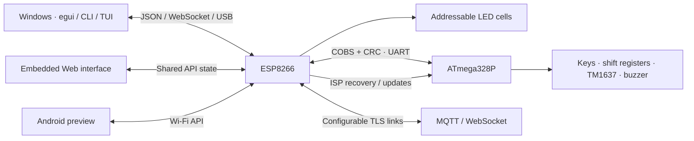

<div align="center">


# PakarController

### Connected boards. One contextual control workspace.

[](https://github.com/atomicdeploy/PakarController/actions/workflows/build.yml)
[](https://github.com/atomicdeploy/PakarController/actions/workflows/codeql.yml)
[](LICENSE)
[](desktop)
[](firmware)
[](https://github.com/atomicdeploy/PakarController/pull/1)

[Overview](#overview) · [Architecture](#architecture) · [Build](#build) · [CI/CD](#continuous-integration--delivery) · [Roadmap](https://github.com/atomicdeploy/PakarController/issues/2)

</div>

> [!IMPORTANT]
> This is an actively developed controller, not a certified production release.
> The expanded application is reviewed in [PR #1](https://github.com/atomicdeploy/PakarController/pull/1).
> Build artifacts, source tests and screenshots are not proof of physical-board acceptance.

## Overview

An ESP8266 + ATmega328P controller with an mpv-free Windows workspace, embedded
Web interface, CLI/TUI and an Android preview. Controls must follow the connected
board's acknowledged capabilities; offline or unsupported peripherals are not
invented by the client. Pealayer supplies real reusable desktop foundations,
PCController supplies protocol/contracts, and the earlier boards supply hardware
mapping and reusable drivers. Exact reuse gaps remain tracked rather than hidden.

<details>
<summary><b>Web device-settings preview</b> — actual embedded UI, simulated device state</summary>


This screenshot is from a read-only HTTP fixture. It is not a live board or a
claim that every requested native/mobile setting is complete.

</details>

## Architecture



## Access and recovery

First-install login: `admin` / `pakarcontroller`; change it in **Device access**.
See [Access and recovery](https://github.com/atomicdeploy/PakarController/blob/feature/pealayer-desktop-foundation/docs/ACCESS.md) and the explicit
[PU850 parity audit](https://github.com/atomicdeploy/PakarController/blob/feature/pealayer-desktop-foundation/docs/PU850-PARITY.md). ESPAsyncWebServer now hosts the
Web UI/API/WebSocket, ESP OTA and AVR ISP in the same firmware.

Version 0.2.7 adds [pinned remote two-board updates and full operational telemetry](https://github.com/atomicdeploy/PakarController/blob/feature/pealayer-desktop-foundation/docs/REMOTE-MAINTENANCE.md).
The [50-route PU850 mapping](https://github.com/atomicdeploy/PakarController/blob/feature/pealayer-desktop-foundation/docs/PU850-ROUTE-PARITY.md) records exact adaptations and exclusions.
Physical and publisher acceptance remain open in [issue #7](https://github.com/atomicdeploy/PakarController/issues/7); no production deployment is implied by a passing build.

PakarController is a two-controller game platform built from the reusable parts of
AtomicDeploy's earlier PuzzleBoard, 40LED, Puzzles, pu850-esp, PCController,
and Pealayer work.

- The ATmega328P owns deterministic keys, shift-register outputs, the ninth
  ADC6 button, TM1637 display, buzzer, melodies, and winner arbitration.
- The ESP8266 owns the MT16703/WS2811-compatible LED field, Wi-Fi/API/UI,
  streaming, self-OTA, AVR ISP recovery, and LittleFS firmware backups.
- Both use the PCController COBS + CRC-8/ATM UART envelope at 38400 baud. The
  AVR uses its hardware UART; the ESP uses SoftwareSerial, while its USB UART
  is a second framed 115200-baud PC transport.
- The Windows controller uses Pealayer's eframe/egui design approach without
  linking or loading mpv.
- Optional outbound cloud links provide TLS MQTT telemetry/commands and a
  configurable WebSocket client. MQTT and WebSocket secrets are write-only and
  stored in checksum-backed LittleFS configuration.
- The PU850-derived network toolbox also includes mDNS discovery and a
  password-authenticated Telnet command shell without taking over either UART.

No I2C peripheral is enabled or required.

See `docs/HARDWARE.md`, `docs/HARDWARE-VERIFICATION.md`,
`docs/ARCHITECTURE.md`, `docs/API.md`, `docs/TOOLCHAIN.md`, and
`docs/LEGACY-CODE-AUDIT.md` before wiring or flashing.

The native Windows app is in `desktop/`. It deliberately has no mpv or
`libmpv2` dependency. Its eframe, reqwest, serde versions and system-aware
visual styling are derived from Pealayer's MIT-licensed desktop foundation.
It can stream a generated rainbow or sample the primary screen into the 10 by
8 staggered table through the authenticated WebSocket.
The Streaming panel exposes a shared target rate (60 FPS by default; 0 is
uncapped) and measured completed host frame writes. This is not measured LED
refresh. Monitor/region selection and live frame-rate acceptance remain open.

## Build

The commands below describe the expanded source on PR #1. Until that application
is merged, select its branch after cloning:

```powershell
git clone https://github.com/atomicdeploy/PakarController.git
cd PakarController
git switch feature/pealayer-desktop-foundation
```

On the Windows hardware host with Arduino CLI and the locked libraries
installed (FastLED 3.10.6, WebSockets 2.7.2, PubSubClient 2.8.0,
ESP Async WebServer 3.12.1, ESP Async TCP 2.0.0):

```powershell
.\tools\build-firmware.ps1 -LinkMode polling
.\tools\build-firmware.ps1 -LinkMode busy-wire
# PU850-style repository entrypoint; also runs the protocol tests
.\build.cmd
```

Linux/CI uses `./build.sh polling` and `./build.sh busy-wire`. CI builds both
variants; the deployed pair must use the same link mode. Every merged
AVR+Urboot artifact must be exactly 32 KiB.

The script compiles the ESP8266 image and the exact MiniCore ATmega328P target,
then verifies that `build/avr/avr.ino.with_bootloader.bin` is a complete 32 KiB
application plus Urboot image suitable for the ESP ISP programmer. Run
`.\tools\test-protocol.ps1` for the native COBS/CRC bounds and corruption test.

Build the Windows application with:

```powershell
.\tools\build-desktop.ps1                 # Check, no executable link
.\tools\build-desktop.ps1 -Mode Test      # Changed native behavior
.\tools\build-desktop.ps1 -Mode Release   # Only when an app update is needed
```

Build storage policy: [docs/BUILD-STORAGE.md](https://github.com/atomicdeploy/PakarController/blob/feature/pealayer-desktop-foundation/docs/BUILD-STORAGE.md). Native
debug/test symbols are disabled by default, with incremental reuse retained.
Build scripts refuse low free space or an oversized canonical Cargo cache.
Firmware compilation is incremental; use `-Target avr` or `-Target esp8266` for
an isolated board change and `-Clean` only when diagnosing a stale cache.
Linux supports `./build.sh busy-wire esp8266` (optional third argument `--clean`).
Use one stable staging directory and `tools/stage-desktop.ps1`; identical builds
skip copying. Fixtures can run directly from the canonical built executable.

Before any task or tool failure, follow [donor-first preflight](https://github.com/atomicdeploy/PakarController/blob/feature/pealayer-desktop-foundation/docs/REUSE-PREFLIGHT.md):
`./tools/consult-reuse.ps1 -Concern build-storage` (or capture, ui-shell, preferences,
windows-desktop, network-cloud, firmware-hardware, updates-telemetry, games-streaming).
Read actual matched donor code before a replacement or unsupported claim. Build,
stage and capture wrappers enforce hash-bound reviewed-slice gates automatically;
pending mappings remain visible and are not accepted exclusions.

The same executable provides scriptable CLI and interactive TUI surfaces. Set
`PAKAR_ENDPOINT`, and optionally `PAKAR_USER` / `PAKAR_PASSWORD`, then use:

```powershell
PakarController.exe --status
PakarController.exe --command cell 17 red fade
PakarController.exe --command mode snake
PakarController.exe --tui
```

Logical IDs are row-major: 1 is upper-left, 2 is next to it, and 11 begins the
second row. Graphical tables offset one-based odd columns by half a cell in Y;
each cell contains six LEDs. Physical strip order is a separate editable map.
The interactive terminal now has contextual pages, shared Find/selection,
explicit bulk white/red/off actions and the shared CLI command palette.
See [terminal controls and remaining acceptance](docs/TERMINAL-UI.md).
Staggered graphics, richer editors and full TUI parity remain open in issue #2.

## Continuous integration & delivery

The expanded [CI/CD pipeline on PR #1](https://github.com/atomicdeploy/PakarController/blob/feature/pealayer-desktop-foundation/.github/workflows/build.yml) checks generated interface,
branding and donor-evidence contracts, tests both UART build variants, builds
the Windows client and analyzes/tests/builds the Android preview. It stops at
the first failed command. Timeouts, superseded-run cancellation and short artifact
retention bound wasted work. The default-branch Build workflow remains the initial
build until the application/CI upgrade is reviewed and merged. [CodeQL](.github/workflows/codeql.yml) scans Actions
and JavaScript; it does not claim Rust, AVR C++ or physical hardware coverage.

The expanded pipeline supports version tags and explicit owner dispatch for **draft prereleases**, with
Windows and two-board firmware packages, Android preview, SHA-256 checksums,
source/run manifest and provenance attestation. No automatic flash occurs and
no development artifact is silently promoted to a production release.
See [repository governance and exact donor mappings](docs/REPOSITORY-GOVERNANCE.md).

## Documentation & contribution

| Start here | Purpose |
|---|---|
| [Hardware](docs/HARDWARE.md) | Pin mapping and wiring |
| [API](docs/API.md) | Device transport and commands |
| [Architecture](docs/ARCHITECTURE.md) | Board responsibilities |
| [Source comparison](https://github.com/atomicdeploy/PakarController/issues/3) | File-by-file reuse and justified omissions |
| [Production checklist](https://github.com/atomicdeploy/PakarController/issues/2) | Open acceptance and delivery work |
| [Repository governance](docs/REPOSITORY-GOVERNANCE.md) | Labels, settings, CI/CD and release policy |

Read [CONTRIBUTING.md](CONTRIBUTING.md) before changing code or wiring. Report
bugs with the device/application versions, acknowledged capabilities and
transport; redact credentials and personal telemetry. See [SECURITY.md](SECURITY.md)
for private vulnerability reporting. Licensed under [MIT](LICENSE); donor notices
and applicable third-party licenses must be retained.
