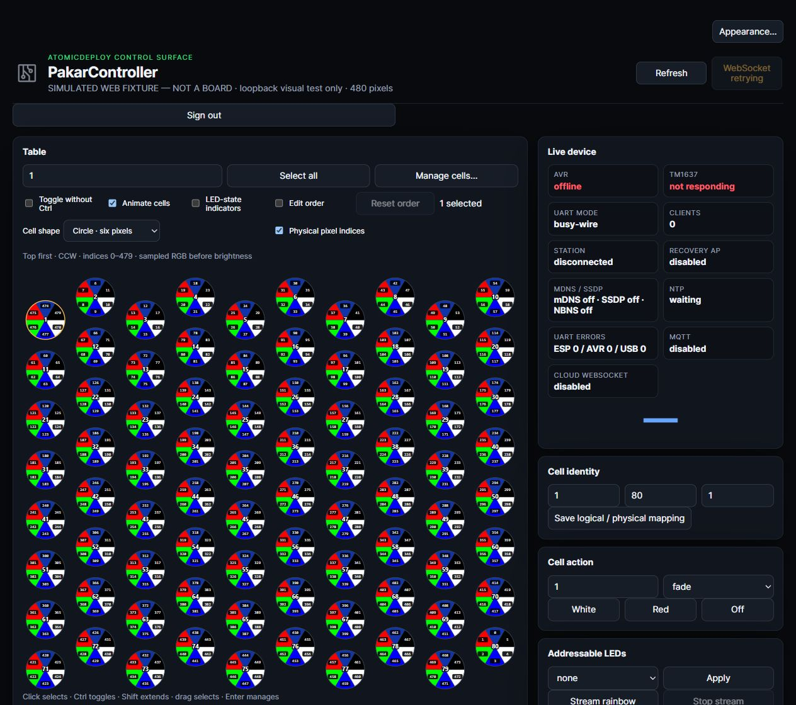
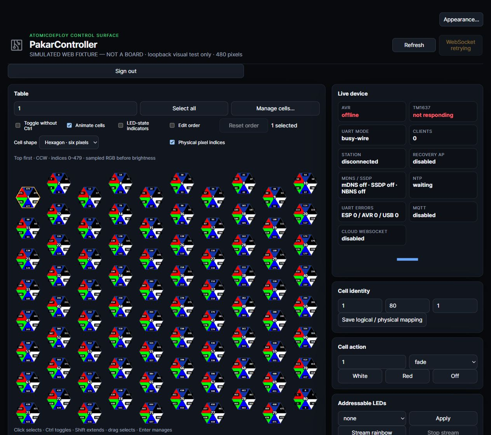

# Six-pixel cell view

Native and embedded Web expose Cell shape: Circle (default), Hexagon or the
existing Rounded surface. Pixel indices is separately configurable, default off.
Native also exposes both under Workspace preferences. Settings are client-local,
saved only when changed, and never write LEDs or remap a device.

Six sectors: top, upper-left, lower-left, bottom, lower-right, upper-right (CCW).
Hexagon labels sit beside their corresponding sides; circle uses the same six
angular wedges. RGB fills are independent of the selected amber outline: no
selection tint. Fixed hit slots, half-row stagger, Find/selection, keyboard,
marquee, bulk targets and edit-only drag order remain intact. Long names are
shortened inside the face, with full names in tooltips.

## Authoritative RGB and physical numbering

Authenticated GET `/api/status?pixels=1` adds `pixel_preview_requested: true`
and `pixel_frame`: revision, brightness, 2880 hexadecimal RGB characters (480
physical pixels) and the current 80-cell physical mapping. GET without the opt-in
keeps its existing payload; WebSocket/cloud/USB status does not gain continuous
480-pixel broadcasting. Password-prompt command:

```powershell
curl.exe --user YOUR_USER "http://ledboard.local/api/status?pixels=1"
```

This is the committed ESP render buffer BEFORE FastLED brightness/TypicalLEDStrip
correction, not optical measurement. Donor BRG versus current RGB still needs
physical R/G/B acceptance. There is no new LED animation FPS limit.

Wi-Fi clients sample at their existing two-second HTTP status cadence while a
sector view is active, including with WebSocket status connected. This is
diagnostic sampling, not frame-perfect animation mirroring. Rounded stops pixel
requests. Missing/invalid/stale (five seconds) data, partial streamed frames or
allocation failure shows neutral sectors and RGB unavailable. Cell white/red/off
state and sampler intent are NEVER invented as pixel truth. Known mapping can
still label indices. USB-only native operation never borrows a different Wi-Fi
peer's frame/mapping; USB per-pixel telemetry is explicitly not implemented.

Indices are ZERO-based 0–479: `(physical_cell - 1) * 6 + sector`. Logical IDs stay
one-based 1–80; presentation drag order never changes this formula. The shared
fixture maps logical cell 1 to physical cell 80: labels 474–479, not 0–5. Tooltips
list all six exact RGB values.

LedGrid serializes only after show, never a partial staged chunk. Five state
bytes replace any need for a second 1440-byte RGB buffer or flash/SSD persistence.
Partial streams wait for commit or an explicit replacing command. Snapshot
allocation failure returns null; status expansion failure returns 503. Immediate
cell changes now explicitly render before show: previously equal current/target
values could skip rendering the changed cell.

## Actual reuse and concrete boundaries

- Pealayer `src/ui/hardware_control.rs` bounded indicator allocation/painting and
  `src/ui/controls.rs` fixed neutral control slices were consulted. Six-sector
  geometry/physical RGB decoding is new Pakar hardware-domain code, not a falsely
  claimed donor implementation. Full generic hardware manager/controls imports
  remain pending in #3. Existing actual `src/ui/dialog.rs` fixed-slot/inside-stroke
  manager adaptation and its complete-read comparison/omissions are retained.
- ControllerBoardMini/Puzzles `LocalLib/WS2811.h` and `.cpp` were reread fully:
  WS2811 setup, full brightness and TypicalLEDStrip correction remain. AVR D6's
  eleven-pixel buffer is not duplicated for 480 pixels on ESP; BRG reconciliation
  retains its exact pending reason in the existing ledger.
- Pealayer artwork/favicon, menus, shortcuts, icon picker and appearance anchors,
  plus PU Shell/Telnet mappings were rereviewed before target hashes were rebound.
  Source hashes matched; no new whole-file parity claim. Shell registry/event
  routing/serial-shell and useful donor UI gaps stay open.
- The existing `tests/web_appearance_fixture.mjs` gains `--pixels`: no second
  capture package, real board, secret, file log or writable device endpoint.
  Rendered verification uses the computer-use skill's supported browser workflow.

## Verification and release boundary

`tests/web_cell_table_test.mjs` executes shipped SVG/controls and shared
`assets/cells/pixel-contract.json`: six distinct colors, CCW positions, remapped
indices, persistence, shortened/full names, identical-render skip, missing/stale/
invalid frames and no hardware writes. Existing selection/order/drag/bulk tests,
appearance/access/display/remote/branding/menu/capture source checks pass.

`tests/led_grid_test.cpp` executes actual LedGrid.cpp with Arduino/FastLED doubles:
committed RGB/mapping, immediate writes, partial-frame isolation, staged commit,
patterns, replacement and allocation failure. Both existing protocol runners
include it. Native Rust consumes the same geometry fixture, but execution stops
at the mandatory canonical-cache >8 GiB guard. No bypass, cleanup reroute,
alternate cache, release build or running-app replacement.

Both ESP profiles compile using existing warm caches. Final image SHA256s:

- busy-wire: `19b03521f57596946e1cced4e0c564fb801e2c71ed08d1c25e184eb7f8a5fdf4`
- polling: `bb7b1429ff3dd01657ded81043e9a411beb0e245bfe260e786b483509a14bd45`

IRAM remains 96% used: these are candidates, not physical acceptance. AVR,
UART contracts and dependencies were not changed/rebuilt. ASUS localhost:1022
still refuses SSH; no board/EEPROM writes. CI is not waited on.

Current Web was visually inspected against the clearly labeled read-only
simulated peer: both shapes, side indices, amber selection and Find cell 1
observed. These are NOT native or physical-device screenshots:





JPEG SHA256s: circle
`3f6e1204cbf188f348df00ce6e124d6921068111a6bd4bd7e71ea5d970378232`;
hexagon `bfeaf56a7f03c6aef135285dfb78bf08e43739ba1eeba2aeb0e77c23b80c23d7`.

Remaining: native compilation/tests/deployed captures after owned-cache recovery;
physical authenticated snapshot readback and OTA/ASUS deployment when reachable;
independent chip R/G/B verification; optional negotiated USB telemetry. #8 tracks
the feature and #3 tracks donor gaps. No whole-project completion is claimed.
