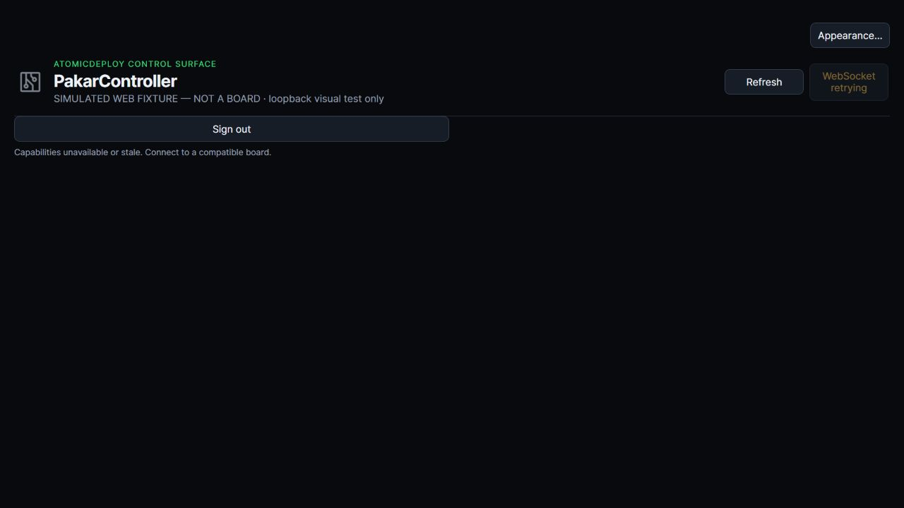
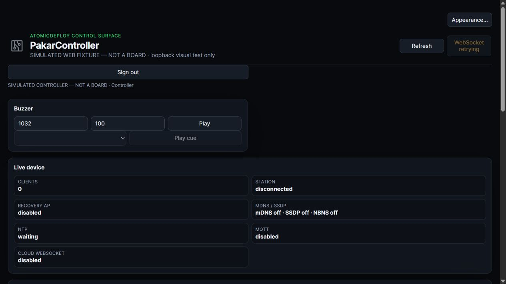
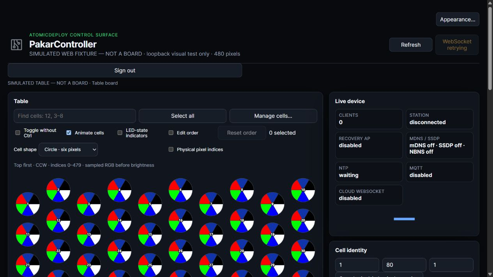

# Acknowledged device context

Tracking: [issue #10](https://github.com/atomicdeploy/PakarController/issues/10).
This is a source/firmware-build/Web-fixture checkpoint, not live desktop or physical acceptance.

## Authority and transport

`libraries/BoardCore/src/DeviceContext.h` owns the ESP profile policy.
`firmware/esp8266/esp8266.ino` publishes the same living `capabilities`
object through authenticated status JSON and its WebSocket status feed:

```json
{"board_kind":"table","name":"ledboard",
 "acknowledged_features":["table","leds","streaming"],
 "table":{"columns":10,"rows":8,"pixels_per_cell":6},
 "modes":[{"id":"snake","code":3,"label":"Snake","kind":"presentation"}]}
```

This example is not a claim about the current physical board. The firmware
computes the complete actual response. The Table profile is explicit firmware
configuration (`PAKAR_TABLE_ENABLED`, default 1), not an inference from 480
pixels, hostname, cached preferences or a version. Setting it to 0 excludes
Table and its modes; the host policy test compiles and exercises both settings.
`PAKAR_FIRST_WINS_ENABLED` separately gates that Table game (default 1).

Existing 29 USB status bytes are preserved. Bytes 29–37 append reserved zero, 16-bit
feature mask, mode mask, board kind, columns, rows, pixels-per-cell and reserved
byte. Old USB status cannot invent a Table. Feature mask bits 0–12 are network,
telemetry, LEDs, streaming, Table, Display, Text, Buzzer, inputs, outputs,
settings, ISP and OTA. This mask is distinct from legacy AVR HELLO bits.

## Individual acknowledgements

| Feature | Required evidence |
|---|---|
| Display / Live display | Valid current AVR HELLO advertising TM1637 **and** fresh display-status hardware ACK |
| Text | Display evidence **and** independent HELLO `kCapDisplayText` support bit |
| Buzzer | Valid current AVR HELLO advertising Buzzer, not a melody catalog or generic online flag |
| Inputs / outputs | Their respective current AVR HELLO bits |
| First wins | Advertised Table game, enabled firmware flag and acknowledged inputs **and** outputs |
| Snake | Advertised **Table presentation**, never a generic controller game |

Passive buzzer wiring has no electrical presence feedback: HELLO acknowledges
the firmware's installed adapter, not that sound was physically heard. TM1637
does have bus ACK feedback. Its 3-second status lease expires independently of
the other AVR capabilities. The AVR link itself expires after 3 seconds without
frames. No support claim is substituted for a failed TM1637 ACK.

## Client behaviour

Native `desktop/src/capabilities.rs` adapts the actual PCController ready AND
advertised rule. Only the **selected fresh command route** supplies context;
Wi-Fi and USB cannot lend each other capability evidence. Desktop status lease
and the Web 8-second lease revoke unavailable context. Panels, toolbar/menu
entries, shortcuts, status labels, settings navigation and viewport/header title
are contextual. Local connection, application preferences and Events remain
available while disconnected; board modes and peripheral cards do not.

Live display includes numeric controls independently of Text. Cards are omitted,
not rendered as unrelated disabled placeholders. Restored workspaces are pruned
before tab headers paint. Per-peer dock caching is memory-only and bounded;
discovery does not write preferences. Switching context clears cell selection,
mapping and pixel readback, cancels unsent edits and stops Table sampling/streaming.
Capability loss closes Table editors and stops commands. Already submitted
commands cannot be retroactively undone; uncertain writes are not retried.

Relevant legacy USB, HTTP and cloud mode/cell/display/audio/output commands are
checked again by firmware. This is not a universal authorization redesign of
all legacy PCController opcodes. Authentication remains separately required.

## Exact reuse and remaining useful code

- PCController `Tools/Controller/web/src/peripheral-availability.ts`: actual
  connected/status/capability conjunction adapted into the manifest policy.
  Display now additionally requires measured ACK, and Text has its own bit.
  Its sensor bounds/invalid-value fields are not applicable to this board's
  absent INA219, temperature, PWM, LCD, RF, relays or Bluetooth drivers; they
  must be retained in a future detected-hardware adapter, not guessed here.
- Its `.test.ts`: disconnected, pending and capability-free cases adapted into
  shipped-Web/firmware regression tests. No simulated sensor values substitute
  for unavailable hardware.
- Pealayer `src/ui/board_info.rs`: fully read; peer-owned capability badges,
  conditional hardware sections and information/settings ownership adapted.
  Full typed profile/identity transport, settings readback and remaining
  advertised sensor/relay/PWM/RF/LCD/macro contracts still need a real adapter.
  Fixed K1–K4 previous/next/decrease/increase labels do not describe our nine
  shift-register/ADC keys and are not copied as false identities.
- Pealayer `src/ui/status_bar.rs`: consulted hardware-status slice only;
  advertised-board/optional-telemetry gating adapted. Whole-file generic status,
  warning and preference parity remains pending, not certified by this slice.

Exact original-byte source hashes, normalized target/test hashes, anchors and
per-code omission reasons are in the existing file-comparison ledger.

The current renderer deliberately fails closed for unsupported Table geometry
instead of forcing arbitrary peers into 80 cells. USB identity is still a
port-scoped label, not a strong hardware ID. A general native-PCController
contract adapter, arbitrary inventory-driven controls/modes, strong board IDs
and simultaneous independently routed multi-board workspaces remain open.
The mobile client and old CLI/TUI domain menus are not certified contextual by
this pass. Firmware-side relevant command guards also protect those callers.

## Verification and deployment boundary

- Passed: production C++ context policy including Table-disabled profile;
  protocol/LED/ISP/Telnet/busy-line/audio/access/remote-state/front-panel/PC
  profile host tests; embedded Web context/access/cell/display/remote tests.
- Passed: Rust source parsing with the project's edition 2024, menu source
  guard and crate boundary guard. This is **not** Rust type checking or tests.
- Compiled: AVR and ESP8266 busy-wire and polling profiles, using existing caches.
- Native Test wrapper stops at the existing >8 GiB canonical cache guard.
  No duplicate cache, guard bypass, donor build or running-app replacement.
- ASUS SSH localhost:1022 refused. No physical flashing, EEPROM writes or
  loss/recovery tests performed. CI is not waited on.

Read-only embedded-Web fixtures were inspected in the browser and captured:





These images are explicitly simulated, not the live native app or board.
Native display/USB switching tests, release build/runtime screenshots, paired
firmware deployment and physical TM1637 ACK loss/recovery remain unchecked in #10.
