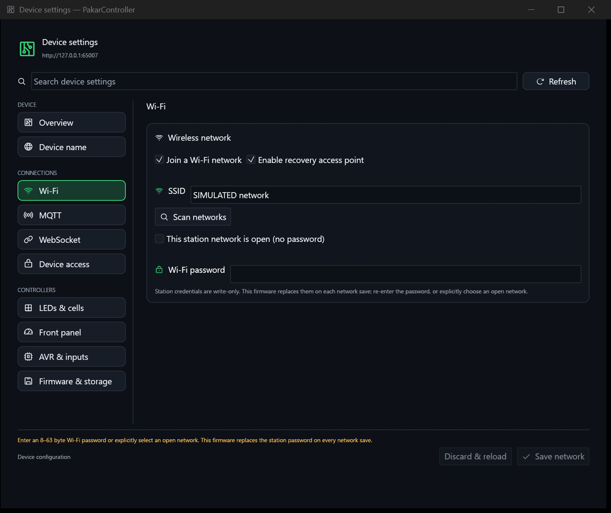
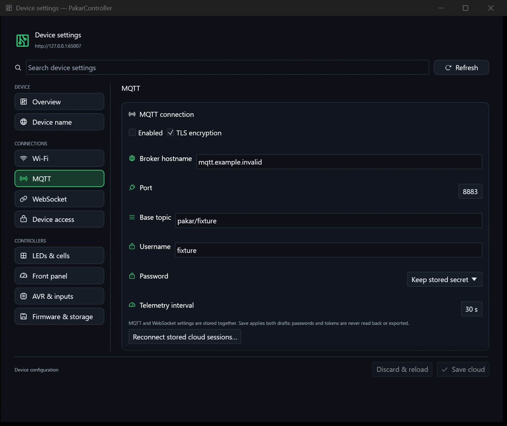

# PakarController device settings

Open **File → Device settings**, press **Ctrl+Shift+,**, or run:

```powershell
.\PakarController.exe --device-settings
.\PakarController.exe --settings-page wifi
.\PakarController.exe --settings-page firmware
.\PakarController.exe --app-status
```

Stable pages: `overview`, `identity`, `wifi`, `mqtt`, `websocket`, `access`,
`leds`, `front-panel`, `avr`, `firmware`. Secondary launches use the actual
single-instance dispatcher; they do not create a second GUI. Settings search
matches real parameter-domain keywords. Appearance/application preferences
remain separate from settings stored on the boards.

## Exact coverage

| Page | Actual controls and source contract | Persistence / verification |
| --- | --- | --- |
| Overview | Peer hostname, firmware, UART mode, pixels, NTP synchronization; connection and app preferences | Fresh selected-route state only; unavailable is not synthesized |
| Device name | Rename, validation, canonical hostname endpoint | `/api/v1/device/name`; existing persistence acknowledgment before endpoint switch |
| Wi-Fi | Station/AP flags, SSID, password/open-network choice, scan and discovered SSID selection | `/api/v1/network`, `/api/v1/wifi/scan`; validated POST acknowledgment plus exact public GET readback |
| MQTT | Enabled, TLS, hostname, port, username, base topic, password keep/replace/clear, telemetry seconds | `/api/v1/cloud`; all public fields and secret-presence flags verified |
| WebSocket | Enabled, TLS, hostname, port, path, token keep/replace/clear, telemetry seconds | Same shared cloud configuration/save; reconnect via `/api/v1/cloud/reconnect` accepts a request, not successful connectivity |
| Device access | Observed storage readiness/default-login notice; username/password/confirmation validation | Existing `/api/v1/auth/info` and `/api/v1/auth` contract; login change invalidates sessions |
| LEDs & cells | Navigation to actual effect controls and mapping editor; logical/physical/name distinction | Existing brightness/effect/mapping APIs and USB operations, not cloned mock controls |
| Front panel | Actual segment mirroring and presentation; brightness, text/number, scroll speed, one-shot/loop/interval, hold/release; advertised melodies and custom tone | Existing display/audio/buzzer APIs/USB commands; presentation defaults saved locally, not misrepresented as device EEPROM parameters |
| AVR & inputs | Actual hardware monitor, input/output state and controls, UART errors, latch status | Current advertised hardware state; build-only parameters explicitly identified |
| Firmware & storage | ISP probe, backup, fixed-size flash/EEPROM export, AVR binary staging/programming, interrupted-program recovery, ESP binary OTA | Real ISP/OTA routes; confirmations and positive result checks; never automatic mutation replay |

USB Wi-Fi provisioning remains available when USB is the selected fresh route.
It creates an explicitly labeled **new request**, validates/chunks the existing
0x53 staging protocol, and reports only that provisioning was queued. This
serial protocol has no saved-settings readback or tracked write acknowledgment;
verify over authenticated HTTP after reconnecting. It is not called a confirmed
save.

## Save and maintenance behavior

- No placeholder network/cloud defaults appear as device state. Required JSON
  fields must be present and valid before a draft can be populated.
- Dirty drafts survive refresh. A conflicting remote snapshot blocks saving
  until discard/reload. This is not an ETag/transactional multi-client guarantee:
  the current firmware API has no compare-and-set revision.
- Wi-Fi changes warn before applying. The firmware replaces the password on
  every network save; enter it again or explicitly choose an open network.
- MQTT passwords and WebSocket tokens have distinct keep, replace and clear
  wire semantics. Password values are write-only/in-memory, never included in
  preferences, IPC snapshots or the settings export. Readback verifies presence,
  not byte-for-byte secret equality. Memory clearing is not a secure zeroization
  guarantee.
- Changing endpoint or credentials invalidates the device draft, secrets and
  pending result identity. Late results from another peer cannot populate it.
- Save/maintenance progress reports a pending operation, not invented percent.
  Ambiguous transport/readback failures never automatically retry a write.
- Firmware operations require explicit confirmation. AVR staging accepts a
  complete 32768-byte binary; it is separate from programming. Exports require
  exactly 32768/1024 bytes and create a new file without overwriting an existing
  PC file. Flash length alone is not authenticity or checksum proof.
- Programming targets the **shared current staged image**. The API does not
  advertise its hash, so the UI explicitly warns about multi-client replacement
  and requires provenance/electrical confirmation. Recovery is explicit when
  the programming latch is active.
- ESP OTA accepts an uncompressed E9-header `.bin`; header/size checks do not
  establish board compatibility or authenticity. Device acknowledgment is not
  proof the new firmware successfully booted. Compressed uploads/optional MD5
  remain available in the device's Web updater rather than this native picker.

## Intentionally not presented as writable

The current firmware does not expose runtime setters for AVR clock/fuses,
pin ownership, debounce, busy-wire build mode, WS2811 chipset/channel order or
pixel count, NTP server/timezone, AP password, EEPROM restore or generic telnet
parameters. Their absence is a **firmware capability gap**, not an assertion
that these features are unnecessary. No ineffective switches were invented.
Native cloud validation temporarily rejects public quotes/backslashes because
the firmware's public JSON serialization is not universally escaped.

## Concrete Pealayer mapping

- `desktop/src/ui/device_settings.rs` invokes the actual imported
  `desktop/src/ui/dialog.rs` navigation, section/card, setting-row, text-edit,
  footer, opaque-frame and bounded-geometry functions. It shares native and
  embedded contents rather than duplicating settings implementations.
- `desktop/src/ui/icons.rs` supplies actual Phosphor glyphs and the shared
  restored picker vocabulary/tests. `config::apply` applies the existing donor
  palette/accent/fonts/scaling to the native settings viewport.
- Existing identity/access/front-panel/hardware widgets in
  `desktop/src/ui/shell.rs` are invoked directly. LED/mapping navigation opens
  existing controls; this does not imply entire donor file parity.
- New contracts/live writes: `desktop/src/device_settings.rs`,
  `desktop/src/maintenance.rs`, `desktop/src/main.rs`; typed deep links and IPC:
  `desktop/src/platform/instance.rs`, `desktop/src/ui/shell.rs`.
- The workspace picker call and all eleven restored icon tests were rereviewed
  after shell changes. Only that established comparison's target hash was
  rebound; no pending donor file was silently promoted.

## Evidence and remaining acceptance

`cargo test --locked --bin pakarcontroller`: **60 tests pass**. Tests cover
missing required fields, all cloud/network fields, public readback mismatch,
negative acknowledgment/no replay, secret semantics, dirty/conflicting drafts,
peer identity, close protection, USB staging/chunks, image bounds, multipart
staging acknowledgment, programming verification, export length/overwrite
protection and page/deep-link coverage. Pealayer palette/picker tests remain.

`tests/settings_ui_fixture.mjs` runs a visible **SIMULATED loopback peer**, its
own isolated profile and owned GUI PID. It navigates via production CLI/IPC and
captures Overview/Wi-Fi/MQTT/Firmware using the repository's read-only screenshot
exporter. Its JSON receipt binds the screenshots to PID and binary SHA-256 and
asserts all fixture requests were GET. These images are not physical board or
write acceptance. The Windows capture service failed twice with 0x8007041D;
no mouse/keyboard automation was used as a substitute.

Actual fixture renders (not live-board proof):




The inspected release binary SHA-256 is
`433d3340c32d50f085c0a212bed03479c71d37c4014a2fdcca736beab9113d00`.
The simulated GUI owner was PID 76324. The restored real-profile GUI owner was
PID 82564; its settings snapshot reported no network/cloud state loaded and
device offline, rather than claiming a real-device configuration. The user's
preference file SHA-256 remained
`950ef1e73d2de8d6e37ea20e0cd953fe520e9d8aedf69f3dc94bb7d1a8b3a2c9`
through graceful replacement and fixture isolation. Runtime PIDs are evidence
for this checkpoint, not stable identities.

The real profile was preserved and reopened at `http://ledboard.local`.
ASUS SSH `localhost:1022` is currently refused and the board name unresolved.
Hardware configuration save, ISP, OTA, melodies/display and both-PC acceptance
therefore remain unverified here. Web/mobile settings parity and the larger
file-by-file donor backlog remain open in GitHub issues #2/#3. This native
settings checkpoint is not a complete production-release claim.
