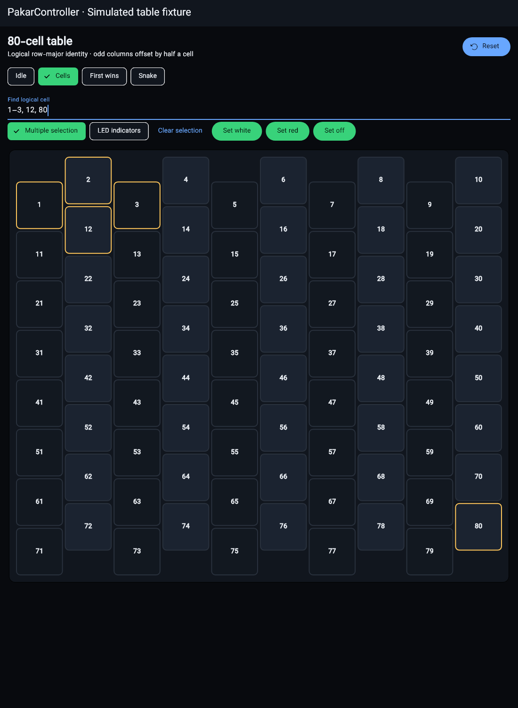

# Acknowledged mobile context and RayanLamp reuse

This is source, Flutter renderer and preview-package evidence, not physical
Android/ESP/AVR acceptance or a production-signed release. Track remaining
context acceptance on #10, platform delivery on #2 and donor imports on #3.

## Actual source mapping

| Actual source read through EOF | Target / adaptation |
|---|---|
| PCController Tools/Controller/web/src/peripheral-availability.ts | mobile/lib/peer_context.dart: ready AND advertised contract through Pakar schema 1. Individual Display/Text/Buzzer ACKs, strict Table geometry/modes, no inferred cells/peripherals. Display additionally requires measured TM1637 ACK. |
| PCController Tools/Controller/web/src/peripheral-availability.test.ts | peer_context_test.dart/widget_test.dart: unsupported schema, missing ACKs, buzzer-only peer, cross-profile identity, missing IO, invalid geometry and phone/tablet navigation. Different PCController bit values and currently absent sensor drivers are not guessed. |
| Pealayer src/branding.rs | Existing canonical asset generator now produces Dart bytes from the exact desktop/Web master; main.dart resolves bounded inline peer artwork and fallback. File-backed presets/media playback states are not blindly copied to ESP/Android; useful icon preferences/launcher artwork remain pending. |
| RayanLamp internal/i18n/digits.go | cell_search.dart latinDigits imports the two actual Persian/Arabic-Indic decimal maps; only numeric input is normalized. MIT notice already retained; names, credentials and wire identifiers are not globally rewritten. |
| Pakar desktop/src/ui/cell_search.rs | Dart parse/formatCellSelection adapts sorted range compaction, #IDs, whitespace/semicolon/comma separators, Unicode dash/comma normalization, strict 1–80 bounds and length limit. One selection backs gestures and Find; partial invalid drafts retain the last valid selection. |
| Pakar desktop/src/ui/cell_table.rs cell_surface | Flutter AnimatedContainer uses neutral alternating cell fills, selection-first amber outline, hover/focus precedence, 140ms transition and fixed-width inside geometry; no LED-state tint or column background. |
| Pealayer scripts/storage-hygiene.ps1 via the existing imported helper | build-mobile.ps1 reuses Get-DirectorySummary, canonical mobile/build, existing SDK, preflight gates, resolved locked dependencies, cache/free-space guards and no clean. |

Only complete donor reads are extended in the authoritative
file-comparison-evidence.json. The existing 4,237-row inventory still has 67
complete-read comparisons, 4,170 pending and 42 known compared gaps. RayanLamp
has six complete comparisons out of 2,349 paths. No unread file is excluded or
represented as fully imported.

## Ownership and interaction

Endpoint and credential changes increment a connection revision. Pending HTTP
reads, discovery probes, WebSocket frames and unsent writes cannot migrate to a
new owner. Retained dialogs/commands hold their captured peer/revision. Status
expires after six seconds; ACK loss removes unavailable pages/cards. Overview
and client Connection remain available offline. Application title/inline artwork
are validated; the exact shared PNG is used as fallback, not a substitute icon.

Selecting/searching never changes hardware. Explicit white/red/off bulk actions
send each command once, stop at failure/unknown outcome and report partial
acknowledgment without claiming physical output readback. LED indicators are
configurable and initially hidden. Physical mapping requires an observed valid
80-cell permutation and bounded names; absent mappings show unknown, not invented
physical identity. Invalid segment bytes yield unavailable display state.

## Verification and remaining work

- [x] Analyzer: no issues; 29 Flutter tests pass through the guarded wrapper.
- [x] Actual loaded-font Flutter renderer capture inspected: all 80 cells,
  half-row staggering, alternating dark cell surfaces, unified outline, hidden
  indicators and exact Find selection. Explicit simulated peer, no device writes.
- [x] Warm APK preview built using the existing Flutter 3.47.3/Dart 3.13.3 SDK.
- [ ] Physical phone/tablet and real peer round-trips; production signing.
- [ ] Complete mobile localization/direction, client themes/preferences and all
  shared settings catalog editor/readback surfaces; no English-only parity claim.
- [ ] Mobile circle/six-pixel visualization, diagnostic indices, edit-only reorder,
  marquee selection, keyboard/context menus and professionally retained mapping
  drafts/readback. Native/Web implementations are not falsely certified as Dart.
- [ ] Generic PCController profiles and bounded absent sensor drivers, full
  RayanLamp/Pealayer remaining source imports and native runtime tests.
- [ ] Device deployment. SSH localhost:1022 refused and ledboard.local failed
  resolution in the latest check; no board flash or existing app replacement.

Native cache cleanup was not performed or bypassed; old running app is preserved.
The APK uses the existing debug template signing identity: release-mode preview,
not a production release. CI is asynchronous and was not waited on.

