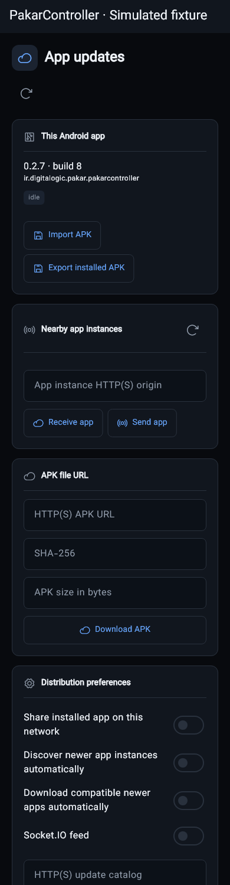
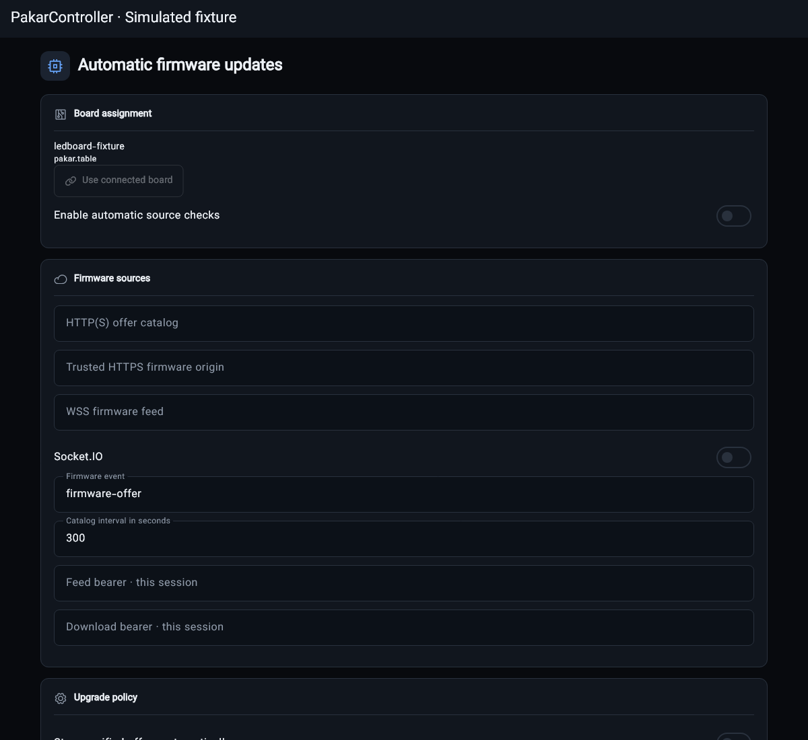
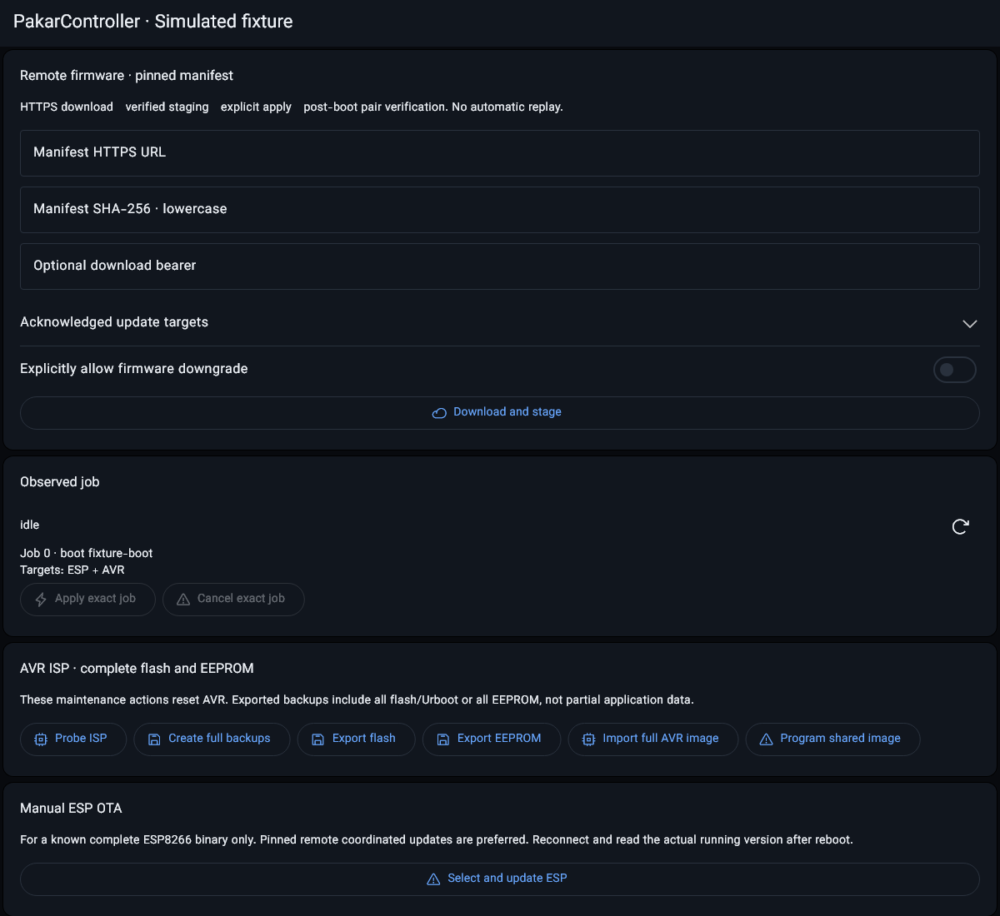
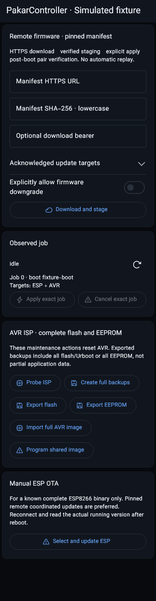

# Mobile firmware and full AVR backups

## Android package distribution and board automation

Current mobile checkpoint: 0.2.7+8. The +8 is Android's monotonic build code,
not a new API generation; ESP/AVR/native software identity stays 0.2.7.
Use the workspace context menu **App updates and replication**, **Automatic
firmware updates**, or the capability-gated **Firmware** page. App updates work
without connecting a board and are not added to the end-user table controls.

- App packages: import/export with Android's document picker, digest/length-bound
  HTTP downloads, and approved app-to-app push/pull. Each package must be newer,
  match this application's package and installed signer set, and support the
  device's Android version and CPU. Transfers are streamed in ordered 16KiB
  chunks into bounded private staging; interrupted writes are never replayed.
- Enable **Share installed app on this network** on a source instance. The
  foreground app exposes `/healthz`, `/api/app-updates` and package-only
  JSON-RPC `/api/rpc`, normally on TCP18992. Enable discovery on receivers:
  `_pakar-update._tcp.` DNS-SD/mDNS, SSDP and MNDP discover candidates; a bounded
  direct manifest GET verifies the product/package/instance before showing them.
  Discovered routes coalesce by instance identity. Discovery is not trust or
  installation permission. Push requires receiver approval and an expiring
  transfer-specific capability; remote callers cannot invoke the installer.
- **Download compatible newer apps automatically** is opt-in. A verified APK
  waits for local **Install update**, Android's unknown-source permission when
  needed, and the OS installation confirmation. Pending user action is not
  success. Installation receipts are correlated to the exact session, digest
  and version, then checked against the running package. No root/silent install,
  split-package export or signing-key-rotation bypass is provided.
- Board **Firmware** retains local ESP/AVR image import, running ESP image
  download/export and full stored AVR flash/EEPROM exports. Direct HTTP(S) file
  URLs require SHA-256 before any board upload. AVR programming uses the
  advertised ISP/Urboot maintenance paths and an exact staged image hash; a
  queued HTTP202 is not flash completion. The unpinned shared-image Program
  action is no longer offered in the UI.
- **Automatic firmware updates** persist an exact board/application assignment,
  source endpoints, interval and independent stage/apply policies. By default
  everything is disabled. Explicit automatic Apply uses the existing verified
  ESP/AVR/both-board manifest transaction with backup/Prog/readback/postboot
  gates; raw AVR offers stage only and raw ESP offers require review. A
  write-ahead consumed-digest receipt prevents restart/reconnect from replaying
  an uncertain mutation. Manual and automatic mobile maintenance are mutually
  excluded. Source credentials are memory-only and do not inherit board auth.
- Both distribution services are app-lifetime, **foreground-only**. Closing
  their settings page does not stop an opted-in service. Backgrounding pauses
  advertising/checks/feeds; resume obtains fresh sessions and board identity.
  This is not an Android foreground-service/background-uptime guarantee.

### Publisher contract

Configure exact catalog/feed/download origins; no endpoint is guessed. A direct
APK HTTP URL is permitted on an explicit local network; remote APK delivery
requires HTTPS. Automatic board image origins require HTTPS. WSS feeds support
ordinary WebSocket or genuine Engine.IO/Socket.IO namespace and heartbeat
handling, with configurable namespace/event. The socket carries small offers;
image bytes are fetched separately over pinned HTTP(S), not unbounded events.

App catalog requests send `X-Pakar-App-Session` and `X-Pakar-App-Package`.
Return a JSON offer or `{ "offers": [...] }` (maximum16/64KiB). An app offer
contains `package`, newer integer `version_code`, `version_name`, `bytes`,
lowercase `sha256`, `url`, the echoed `session`, and `expires_at_ms` (future,
at most60seconds). The downloaded APK is independently inspected natively;
advertised metadata cannot override its signer or contents.

An app feed first receives `subscribe` with `events`, `session`, `package` and
`instance_id`; ordinary WS offers add `type: "app-update-offer"` (or the
configured event). Socket.IO uses the configured event/data tuple instead.
Firmware catalogs send `X-Pakar-Firmware-Session`, `X-Pakar-Board` and
`X-Pakar-Boot`. Firmware offers use the same session/board/boot/deadline/hash/
origin constraints as the existing [firmware inbox](API.md#application-firmware-inbox-file-delivery-and-observed-progress).
They contain `id`, `session`, `board_id`, `boot_id`, `expires_at_ms`, `url`,
`sha256`, `kind` (`binary`/`manifest`) and `target` (`esp`/`avr`/`all`).
Only manifests may target `all`; paired Apply is not an atomic rollback promise.

Actual Android peer multicast/installation consent, configured remote TLS
services, USB-host firmware programming, physical both-board updates and
power-loss acceptance remain open in issue #7/#2/#3. A built APK or simulated
renderer capture does not satisfy them. No board was flashed by this mobile
checkpoint. The earlier results below are historical, not current runtime proof.

Renderer proof (simulated fixtures, not Android/hardware acceptance):

## Earlier manual maintenance checkpoint

Owning issue #7, broader UI/parity #4/#3, production master #2. The Firmware
settings page is no longer a Web-address-copy placeholder. It uses the actual
integrated device contracts; no separate ISP firmware or invented filesystem
browser was introduced. This is app/fixture acceptance, not physical flashing.

## Actual source mapping

| Fully read source | Real target / retained mechanism |
|---|---|
| Pealayer web_ui/src/components/ServerFilePicker.tsx | mobile/lib/documents.dart, Android MainActivity.kt and firmware_page.dart: single selection, cancel, bounded/disabled state, stale ownership, review before acceptance. Android's document provider owns navigation/search instead of an ESP endpoint that does not exist. |
| Pealayer web_ui/src/preferenceFiles.ts | Actual case-insensitive dot-extension suffix rule in documents.dart, executed by the firmware picker. File extension is not authenticity. Provider content URIs are not converted to filesystem parent paths. |
| Canonical Pakar desktop/src/maintenance.rs | firmware.dart: explicit selected targets, HTTPS manifest and lowercase SHA-256 validation, exact job/boot/hash/target pins, phase guards, positive ACKs, full backup/image bounds, truthful stage/apply/completion and no replay. Adds fresh identity read before apply/cancel. |
| Actual ESP RemoteFirmware JSON, MaintenanceRoutes and upload handlers | Exact /api/firmware/remote/fetch/apply/cancel, /api/avr/probe/backup/image/program, stored backup GETs and /update multipart fields. No synthetic defaults or unadvertised EEPROM/fuse restoration controls. |

Original-byte donor hashes, normalized target/test hashes and exact omitted code
remain in file-comparison-evidence.json. Both picker files now have a specialist
mobile-firmware route and a required build gate. This adds two Pealayer reads,
not two RayanLamp reads; RayanLamp remains six fully compared files/2349 paths.
All donors remain read-only. No entire-project parity or superiority certificate.

## Safety and real controls

- Remote staging requires a direct HTTPS manifest, lowercase SHA-256, optional
  in-memory obscured bearer and individually acknowledged ESP/AVR targets.
  Manual staging sends apply=false; only the separately confirmed automatic
  manifest policy opts into apply=true. Downgrades require an explicit switch.
- Apply/cancel confirm the observed job, then reread its identity/state before
  one mutation. A changed job/boot/hash/target sends nothing. A reply must match
  that exact identity and the expected preparation/cancel state.
- Device-reported received/expected bytes are download progress, not fabricated
  flash percentage. Accepted/staged/preparing is never called completed.
- Each ISP/OTA domain uses current selected-board capability ACKs, including
  after awaits. Lost capabilities/changed owners/disposed views reject stale
  replies. Confirmation locks settings navigation but does not show fake
  operation progress; real operations have separate progress state.
- Manual actions first inspect remote ownership. A busy/ready pinned job blocks
  manual staging/programming. ISP probe resets AVR despite being HTTP GET:
  single-dispatch transport never sends it through discovery retries.
- One-dispatch HTTP has response size limits, a total deadline, stream
  cancellation and no redirects. Device credentials stay in headers; remote
  bearer stays in POST body, never query/error logging. Basic auth on plain
  LAN HTTP is still unencrypted in transit and needs a trusted network.
- Any uncertain maintenance failure locks further writes until explicit
  inspection. Background status reads cannot silently unlock or queue retry.
- AVR import is exactly 32768 raw bytes including the intended bootloader.
  It stages only. ESP import requires uncompressed E9 format, 16 bytes–2 MiB.
  A second confirmation reviews the selected name/length before upload.
- Stored flash/EEPROM exports must be exactly 32768/1024 bytes before a file
  is created. They are existing device backups, not claimed fresh live reads.
  Android ACTION_CREATE_DOCUMENT produces a new destination; a one-use token
  can write only that user-created URI. No arbitrary path/URI write, broad
  storage permission, deletion, overwrite-existing path or automatic replay.
- Picker cancellation sends no board mutation. Owner changes before export
  discard the token; a new empty document can remain and is reported. Failed
  provider writes can leave an incomplete new document; never hidden/deleted.

## Concrete limits and remaining acceptance

- AVR staging is shared; a local filename is not proof of the current stored
  image. The current maintenance dialog binds the computed SHA-256 to the
  advertised maintenance API, which rejects changed images before programming.
  Legacy `/api/avr/program` remains a compatibility route, not the UI path.
- Direct ESP upload is not a pinned manifest/profile/pair-authenticity workflow.
  Its positive updated/rebooting ACK is not proof of the running postboot version.
- Manifest hash pins content supplied by the user, not an independently trusted
  publisher signature. mDNS/SSDP and Basic auth are not cryptographic identity.
- Read-only Flutter/model/HTTP/MethodChannel fixtures cannot prove Android
  provider behavior, rotation/process death, TLS publisher trust, actual flash,
  Urboot/EEPROM, Prog latch recovery, power-loss handling or physical peripherals.
- Remembered provider-folder hints, full localized review/preview, generic
  donor server-browser consumers, mobile appearance/back-draft protection and
  production Android signing remain open. No storage permissions added.
- Source version stays 0.2.7 across ESP/AVR/native/mobile. Old production desktop
  and hardware were not replaced. Fresh ASUS SSH localhost:1022 was refused.

Analyzer clean and all 73 Flutter tests passed through build-mobile.ps1. Actual
simulated tablet renderer was captured with Vazirmatn, Phosphor and MaterialIcons,
inspected, and asserts zero board mutations. Phone capture was also inspected;
all four maintenance cards/controls fit its scrollable width without overflow.
Android assembleRelease compiled the actual Kotlin SAF bridge successfully.
The warm cache is 1.029 GiB/4303 files; no new SDK/dependency/cache/clean. Native
desktop and board firmware were not built. Source-quality suite passed.

Preview APK: 53971590 bytes, SHA256
16d5c7d421d60cbc737dbd947cee56fb9219c8e1181ef47447934f1934c09432.
Template debug signing, not production. The previous settings APK was preserved
by verified recoverable rename, not overwritten/deleted. The older rollback was
also retained. Exact evidence is in FILE-COMPARISON-RECEIPTS.md.

The authoritative inventory is 4237 paths: 70 completed comparisons, 4167 pending,
44 known parity gaps. Those counts are a boundary, not a completion claim.
