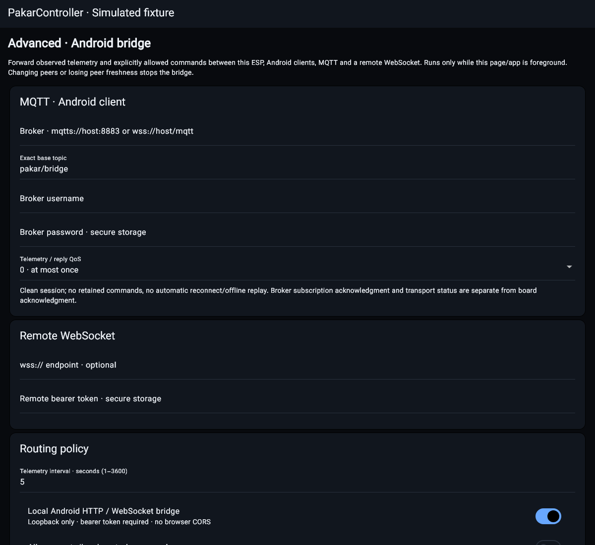

# Android device and advanced network workspace

This is an additive, versionless contract. Firmware/native/mobile descriptive
version remains 0.2.7. Source and fixture checks are not LAN/hardware acceptance.



## Navigation and device ownership

Devices is a client-owned page even when disconnected. It scans automatically
on opening, supports explicit rescan, and keeps up to 64 local/remote HTTP(S)
profiles with independent secure passwords, edit, forget and explicit selection.
Selection retires the prior transport; the board's actual capability manifest
determines type, application identity and controls. A remote endpoint is not a
fabricated board type or a generic PCController RPC compatibility claim.

The app-bar context menu opens Firmware and Advanced MQTT/bridge as separate
routes. They are not cards added to the main Table/front-panel UI. Firmware
visibility depends on fresh individual OTA/ISP acknowledgment. Firmware
confirmation locks back navigation. Existing remote pinned job identities,
fresh apply/cancel checks and Android SAF import/export are retained.

Running ESP sketch export uses the actual `/firmware/download` route; AVR full
flash/Urboot and EEPROM use the existing stored-backup routes. ESP full-flash
dumps remain disabled because they can contain settings/secrets. Direct images
still use the existing exact ESP8266/ATmega328P contracts: do not flash an S3
image through the ESP8266 interface. S3 transfer contracts need actual integration.

## Bridge

An explicit Start creates a foreground-only, selected-board/boot-bound session.
Backgrounding, page disposal or expired/changed board state stops it. This is
not an Android foreground service and does not promise locked-screen uptime.
No automatic start/reconnect/resumed command queue is enabled.
HTTP and WebSocket board/boot changes synchronously retire old Flutter owners;
once critical peer identity is learned, a malformed/missing pair cannot downgrade
back into legacy readiness. A one-second ownership watchdog is independent from
the configurable telemetry interval. Connection correlation is not cryptographic
device authentication; Basic HTTP still requires a trusted ESP LAN.

- MQTT 3.1.1 with verified TLS (`mqtts://host:8883` or `wss://host/mqtt`), clean
  session, configurable exact base topic, username, securely stored password,
  telemetry interval and telemetry/reply QoS 0/1. Commands subscribe at QoS 0.
- Optional verified-TLS outbound WebSocket with securely stored bearer token.
- Optional Android loopback HTTP/WebSocket server on an assigned port. Start
  shows its endpoint and a new session bearer token for explicit trusted-app
  setup. There is no LAN listener/CORS or unauthenticated local command API.
- Telemetry uses an explicit board-field allowlist plus client platform/policy;
  it never forwards raw settings/status containing credentials or Wi-Fi secrets.
- Command forwarding and firmware exchange/staging are separate opt-ins, off
  by default. Unknown paths and non-acknowledged capabilities are rejected.
- Every request requires a unique ID, session, board/boot identity and deadline
  within 60 seconds. Retained MQTT messages and duplicate IDs are rejected.
  An ID is consumed before dispatch, with a 1024-request session budget. Lost
  HTTP acknowledgments latch uncertainty; inspect before starting a new session.
- Remote firmware requests stage an HTTPS/SHA-256 pinned manifest only. There
  is no remote apply/reboot or arbitrary proxy. Applying requires the existing
  firmware-page confirmation and fresh job/boot/hash/target verification.

Local routes (all require `Authorization: Bearer <session token>`):

| Route | Purpose |
|---|---|
| GET `/api/status` | Allowed observed telemetry plus request session |
| GET `/ws` | Telemetry stream and correlated JSON requests/replies |
| POST `/api/request` | Same bounded JSON envelope as remote transports |
| GET `/api/firmware/download?target=esp` | Running ESP application image |
| GET `/api/firmware/download?target=avr` | Existing stored AVR full-flash backup |
| GET `/api/firmware/download?target=eeprom` | Existing stored EEPROM backup |

Downloads require the firmware-exchange opt-in and actual OTA/ISP acknowledgment.
They do not take a new backup, provide release authenticity or flash a board.
MQTT topics are `<base>/telemetry`, `<base>/request`, `<base>/reply`. Telemetry
contains `bridge_session` and observed board identity for a new request:

```json
{"id":"unique-request","bridge_session":"observed-session","board_id":"observed-board","boot_id":"observed-boot","expires_at_ms":1234567890000,"type":"command","path":"/api/brightness","values":{"value":"128"}}
```

Use a current deadline, not the example number. For `firmware-stage`, replace
path/values with `url`, lowercase manifest `sha256`, and `targets` (1 ESP, 2 AVR,
3 both). Do not include credentials in URLs or retained command messages.

## Discovery matrix and limits

| Protocol | Android | Integrated ESP8266 source |
|---|---|---|
| mDNS / DNS-SD | Android NsdManager, serialized resolves, bounded scan, multicast lock cleanup | Existing HTTP/Pakar/stream/Telnet services |
| SSDP | Bounded M-SEARCH scan and validated origin parsing | Existing responder and description |
| MNDP | Bounded multicast/broadcast scan and defensive TLV parser | Added PU-derived bounded TLVs, 30-second announcement and rate-limited query response |

Discovery is metadata-only; no scan sends device passwords or activates controls.
Results remain unverified until explicitly selected and authenticated. Multiple
protocols may advertise one device; do not merge by unauthenticated name alone.
Saved hostnames are preferred; current address candidates are discovery metadata,
not a silent rename. The Android bridge is deliberately loopback-only, so this
pass does **not** advertise a reachable phone API on the LAN (DNS-SD/SSDP/MNDP
responder support for an opt-in authenticated LAN/TLS phone listener remains
separate work). MNDP does not assert application/API compatibility.

S3's present migration scaffold is not the integrated ESP8266 application. This
does not certify S3 discovery, DMA, firmware upload/download or physical pinout.

Remaining acceptance: real MQTT ACL/TLS/subscribe and disconnect behavior;
remote WebSocket integration; Android provider/rotation/background/process-death;
phone LAN discovery on actual routers/AP isolation; actual ESP/AVR firmware
transfer/readback/power loss; complete S3 integration and LAN phone advertisement.
