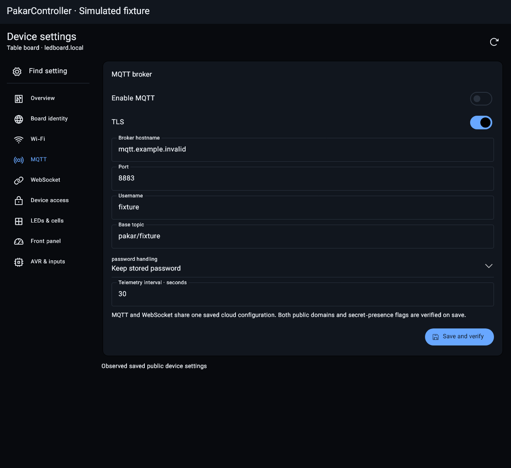
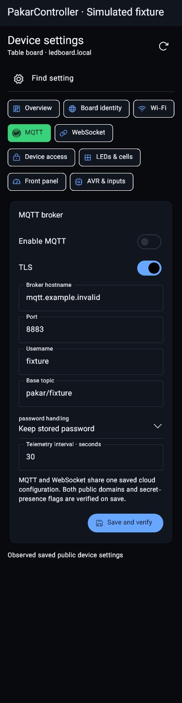

# Mobile device settings: exact imported contracts

This checkpoint provides actual device editors, not a settings catalog pretending
to be implemented controls. It is fixture/renderer/preview-package evidence,
not real Android/ESP/AVR acceptance. Track settings on issue #4 and full delivery
on #2; authoritative donor decisions remain in the existing file comparison ledger.

## Source mapping and concrete differences

| Fully read source | Actual adapted code |
|---|---|
| Pealayer web_ui/src/components/PreferencesTab.tsx, all 593 lines; original SHA256 bada7d4b1cdd332fc51bcbc00ac59544c860f7012eca7d425e477ef932170c27 | mobile/lib/device_settings_page.dart: contract-driven sections, searchable navigation, grouped typed fields, descriptions, reload/save status and retained edits between pages. Flutter replaces Ant Design; existing Studio colors, Vazirmatn and verified Phosphor codepoints remain actual assets, not approximated icon names. |
| Pakar desktop/src/device_settings.rs | mobile/lib/device_settings.dart: required-field/type/UTF-8/bounds validation, distinct secret keep/replace/clear, dirty/conflicting drafts, positive ACK and exact public readback. |
| Pakar assets/web/device-settings.js and assets/contracts/device-settings.json | One shared generated mobile settings catalog, actual network/cloud form semantics, owner/request epochs, explicit single-dispatch save and no uncertain replay. |
| RayanLamp internal/i18n/digits.go | Existing mobile/lib/cell_search.dart latinDigits now also normalizes Persian/Arabic-Indic port and interval input. It never rewrites passwords, hostnames, topics or peer names. |
| ESP routes in esp8266.ino, WebAccess.h and AccessPolicy.h | Board hostname/display name and access forms use the real accepted/persisted and updated/reauthenticate replies, ASCII/UTF-8 limits, explicit confirmations and session-revocation semantics. |

Pealayer optimistic autosave is deliberately replaced for physical devices.
Wi-Fi reconnect and write-only password replacement require explicit confirmation;
a successful UI patch is not evidence of a persisted board save.

## Implemented domains

- Wi-Fi: station/recovery AP flags, real SSID scan/selection, password re-entry
  or explicit open-network choice. At least one network path must stay enabled.
- MQTT: enable/TLS, broker hostname/port, username/topic, keep/replace/clear
  password, telemetry interval.
- Outbound WebSocket: enable/TLS, hostname/port/path, keep/replace/clear token,
  shared telemetry interval. MQTT and WebSocket use one real cloud configuration;
  saved public values and secret-presence flags are checked together.
- Identity: full board display name and hostname, including optional .local
  input; exact persisted ACK before following a rename with existing credentials.
- Access: observed storage/default-credential state, username/current/new/confirm
  password; exact positive ACK before following new credentials. Authenticated
  /api/v1/auth readback is checked with the new login.
- LEDs/front panel/AVR pages navigate existing acknowledged live controls;
  no ineffective UART, fuse, pin or pixel-count runtime switches are invented.
- Overview uses observed build/peer values. Firmware/storage page says explicitly
  that mobile update/file-picker/job controls are not implemented; copying the
  Web address is not their substitute or a completion claim.

Device settings disappear when the owning peer/capability is no longer fresh.
Secrets live only in memory until an explicitly acknowledged login handoff uses
the existing encrypted platform connection store. Normal preferences contain no
secret values. Secret clearing is not a secure-zeroization guarantee.

HTTP writes use one form BODY, never secret-bearing URL parameters. A negative
ACK, timeout, owner change or readback mismatch never automatically replays a
mutation. A successful auth/rename reply can follow the same captured connection
even if its old WebSocket/view has closed; it cannot alter a different connection.
Dirty drafts survive refresh and section changes; changed saved state blocks save
until discard/reload. Firmware has no revision/CAS, so this is not transactional
multi-client conflict prevention. Plain HTTP still needs a trusted LAN.

## Verified evidence

- Analyzer has no issues; all 46 Flutter tests pass through the mandatory wrapper.
  Tests exercise required fields, UTF-8/type/port/interval bounds, secret modes,
  conflict and late-read handling, one POST/negative ACK/lost reply/mismatched
  readback, ACK revocation, numeric script normalization, phone/tablet layout,
  and delayed auth/rename replies after view closure for same/different owners.
- Actual Flutter renderer captures load Vazirmatn, Phosphor and MaterialIcons.
  The latter is part of the existing Flutter bundle, not a downloaded dependency.
  Captures are explicit simulated peers and assert zero device mutations.
  Both inspected layouts contain the full MQTT form and save action.
- Source-quality suite passes all required children, including comparison hashes,
  preflight gates, branding/localization/Web contracts and version consistency.
- Warm release-mode preview builds with existing Flutter 3.47.3/Dart 3.13.3.
  Canonical mobile cache: 1.021 to 1.027 logical GiB, no new SDK/cache/clean.
  APK SHA256: 8b01492724b48daf0d42ed3666f82144c6e7d6aa55d26614eabd25502f00f596.
  Debug-template signing is preview-only, not production signing.

Tablet PNG SHA256: b25da59a2cec4dcb7320eaff0353764d1ac6762dad99cef64e87bc6fb0d0253d.
Phone PNG SHA256: 3459f61adb2e23e6df15912fec9c6c52b0f7a4300b8b5a9d639496bf09f1a233.

## Useful omitted code remains pending

- Pealayer AccentColorPicker/live appearance, rich multi-select, replacement-list
  add/delete, numeric steps/defaults, collapsible groups, full ServerFilePicker consumers and
  dynamic option refresh; their media consumers are not controller business,
  but their generic mechanisms remain useful unfinished imports.
- Full mobile localized labels/direction, themes/preferences, Android-back/quit
  unsaved-draft protection and all
  applicable connection/discovery actions.
- Physical phone/tablet saves/readback, actual MQTT/WebSocket/cloud connectivity,
  hostname/credential reconnection and board deployment, production signing.
- Remaining entire donor-file inventory: 4237 paths, 68 complete comparisons,
  4169 pending and 43 known gaps. RayanLamp stays six compared files/2349 paths;
  its 1827-line settings.tsx was inventoried but is not certified as fully read
  or imported. No full donor superiority or complete production release claim.

The old desktop app is preserved. No new native compilation, physical flash,
EEPROM write or CI wait was performed. Last actual reachability check remains
SSH localhost:1022 refused and ledboard.local resolution timed out; these settings
screens and simulated tests do not establish live hardware behavior.

Follow-on: actual mobile firmware/backup/job controls and Android document picking
are implemented, with two more complete-read Pealayer comparisons and 73 passing
Flutter tests. See MOBILE-FIRMWARE.md. Current inventory is 4237/70/4167/44;
the earlier counts above describe the settings checkpoint, not current totals.
