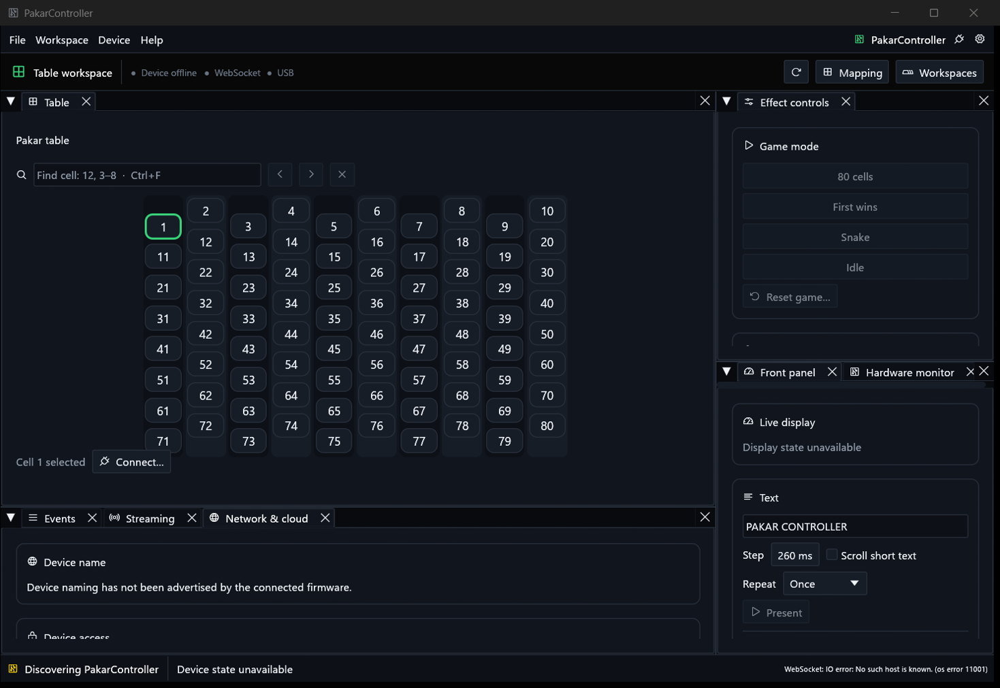
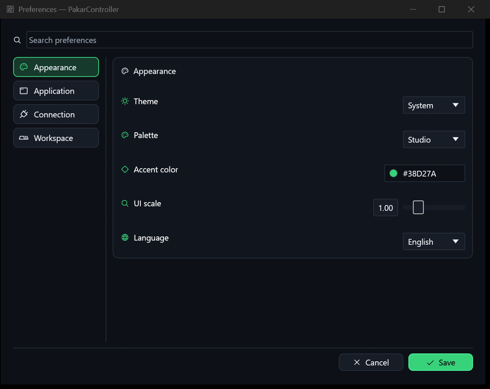

# PakarController 0.2.5 source checkpoint

Refs https://github.com/atomicdeploy/PakarController/issues/2.
This is **not** the completed production acceptance or a hardware deployment.

## Implemented and locally verified

- Fourteen catalog cues now run through the actual production player. The
  separately imported root PuzzleBoard 520 ms and 40LED setup 590 ms variations
  do not replace the default Puzzles 530 ms welcome. Native/Web/mobile require
  advertised AVR cues, based on a versioned HELLO; USB includes the catalog.
- Wi-Fi+USB mode selects one route before each native action/network change;
  it no longer duplicates mutations. Explicit transport and stale serial
  observations are respected. Lost responses do not cause cross-route replay.
- The existing MQTT broker's TLS identity and anonymous rejection passed.
  An exact ledboard ACL alias was staged/validated and hot-reloaded without
  changing passwords or other tenants. This is not ESP cloud round-trip proof.
  See deployment/mqtt/README.md for hashes and the server recovery copy.
- ESP busy HIGH explicitly uses INPUT_PULLUP; receive-ready preloads LOW
  before output enable. Polling builds never touch that GPIO. AVR input
  INPUT_PULLUP remains enabled. Both macro variants build.
- Production AVR TonePlayer keeps the donor's musical deadlines instead of
  accumulating loop delays. The welcome is exactly 530 ms in the source
  schedule; late steps, wraparound, hardware divider, queue capacity, mute,
  resume and idle readback are covered by register-double tests. Hardware
  OC1A output remains on D9; these tests are not an audible recording.
- Actual PU850 Telnet IAC/subnegotiation parser and insert/shift editor are
  adapted, with acknowledgements that avoid negotiation loops. CSI/SS3,
  arrows/home/end/delete/backspace, Ctrl-C/Ctrl-L, split CR LF/NUL, password
  non-echo, scrubbing, overflow rejection and independent state are tested.
  A 96-byte service budget and login/idle expiry bound shell loop work.
- All 14 Puzzles LocalLib files and its complete sketch have been manually
  read, with individual source hashes and honest remaining decisions. The
  broader donor inventory contains 1,868 files, 63 missing sparse paths and
  1,863 unresolved manual/integration decisions. Hash screening is not full
  review. The strict release gate intentionally blocks this scope.
- Existing Android/Flutter source is preserved in GitHub, version 0.2.5,
  with platform-encrypted credential storage and safe legacy migration,
  identity-checked read-only discovery for renamed hosts, no mutation replay,
  Once text default, half-stagger table, alternating columns and exact logical
  search/highlighting. Analyze and 13 tests pass; the release-mode preview
  APK builds. Production signing/physical mobile/full parity stay open.
- Firmware/native/mobile source versions agree; local Windows release build,
  25 Rust tests, ten C++ suites, Web tests, CLI loopback and ledger tests pass.
  GitHub jobs additionally test/build Android preview and version/ledger gates.

## Actual native screenshots

The photographed 0.2.4 process was launched on David-PC. A secondary process forwards to
the same primary PID; live IPC reports single-instance ownership, the dock
panels, Preferences open and device/WebSocket/serial **offline**. The screenshot
helper captures actual app windows, not mock UI. Preferences lives in a separate
native viewport and was captured by its actual observed window title.

These receipts establish rendered native workspace/preferences, not complete
Pealayer parity, light/narrow acceptance, hardware animation or Android visual
acceptance. Those gates remain in PRODUCTION-ACCEPTANCE.md.
These screenshots remain explicitly versioned 0.2.4 receipts, not screenshots
of the additional 0.2.5 cue/routing changes or live board acceptance.

## Current external gate

ASUS SSH at localhost:1022 refuses connections. ledboard.local is unresolved
here and the former board IP times out. No current firmware upload, persistent
device rename, Wi-Fi password change, TM1637/audio/strip verification, cloud
round-trip or ASUS application launch is claimed. The newest user-provided
station password will be used only during deployment; it is not put in GitHub.
Restore ASUS/tunnel reachability to resume physical acceptance. Offline donor,
TUI/Web/menu and parity work remains explicitly open in issue #2.

The Android preview is still debug-signed; no production-signed mobile release
is published. The master issue must not be closed by merging this checkpoint.
