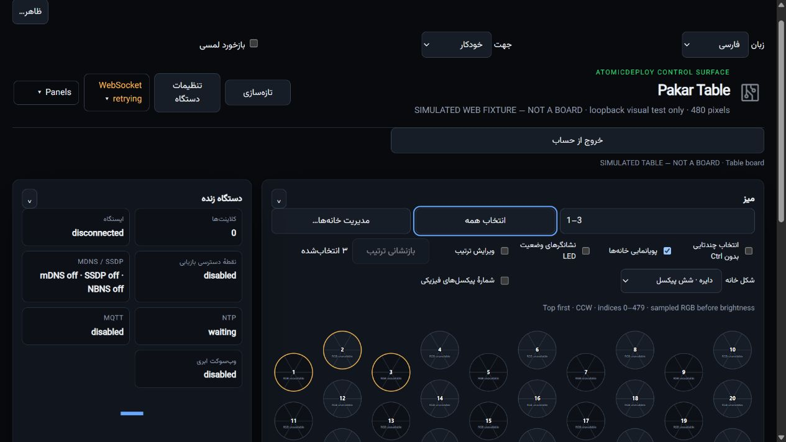
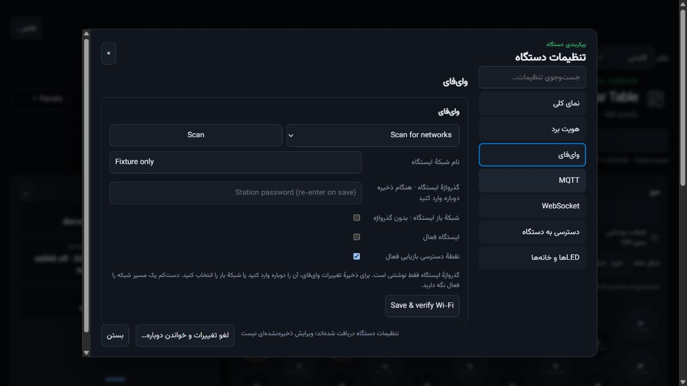
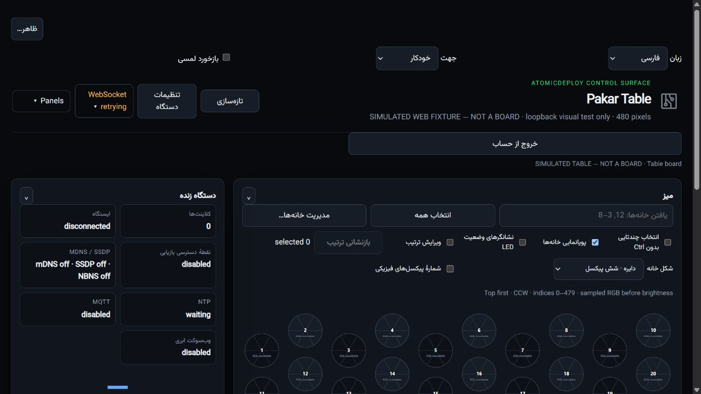
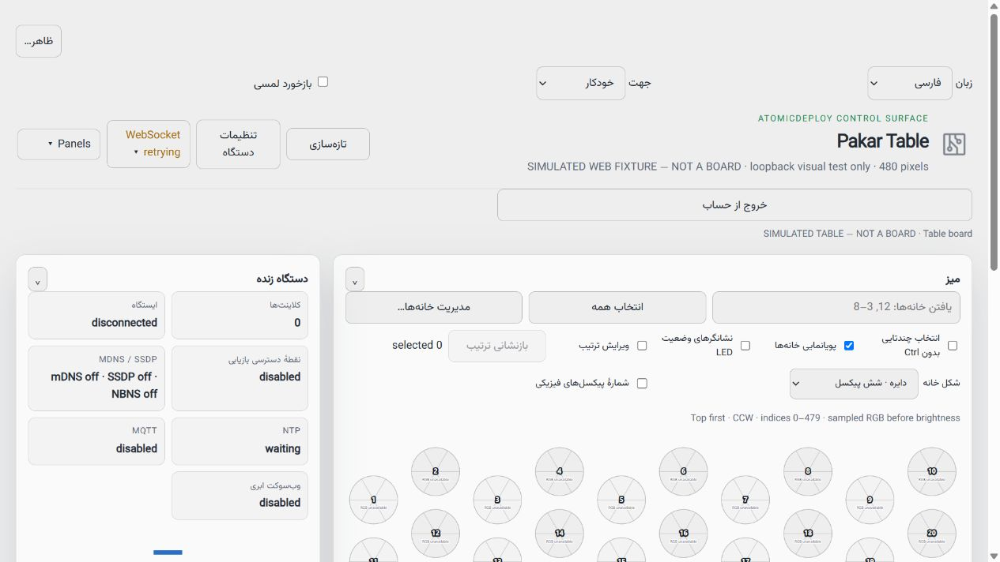

# RayanLamp source reuse

Located task: **Build RayanLamp Go app**,
`019f8cfc-271a-72e1-8747-e3eb883de5ec`, local host.
Donor: `C:\Users\David\Documents\Codex\2026-07-23\ba\outputs\RayanLamp`.
This source directory has no Git metadata. File identities are original-byte
SHA256 snapshots, not a fabricated commit or a claim that old task reports passed
current verification. The last task left settings sizing and border regressions
unverified after interruption. Donor source and task state were not changed.

## Actual imports

| Donor source | Pakar target and use |
|---|---|
| internal/i18n/digits.go | desktop/src/ui/digits.rs, assets/web/rayanlamp.js and mobile/lib/cell_search.dart: actual two decimal-script maps, applied to native/Web/mobile Find cells. Persian and Arabic-Indic IDs produce the same canonical ASCII IDs/ranges; names/protocol payloads are not rewritten. |
| webui/src/haptics.ts | assets/web/rayanlamp.js: actual semantic patterns, bounded audio cue construction, fail-closed visibility/reduced-motion checks, host-error containment and copied pattern arrays. Web appearance has opt-in Touch feedback, default off, disabled when unsupported. Explicit command HTTP success/error triggers it; telemetry and streaming frames never vibrate. HTTP success is not physical actuator readback. |
| webui/src/haptics.test.ts | tests/rayanlamp_reuse_test.mjs: actual donor scenarios adapted to built-in Node assertions, plus unknown cue and mutable-host protections. No Vitest/Go dependency or donor build. |
| webui/src/connection-preferences.ts | assets/web/rayanlamp.js and assets/web/localization.js: actual validated local-event/BroadcastChannel subscription and teardown adapted to client language/direction. Adds storage-event fallback, API failure containment, no identical writes and no rebroadcast. No board drafts, passwords or identity are synchronized by this presentation channel. |
| webui/src/connection-preferences.test.ts | tests/rayanlamp_reuse_test.mjs: persistence, immediate delivery and malformed-value rejection; added blocked API, no-echo and cleanup acceptance. Static-export and lamp URL tests remain pending with their transport implementation. |
| LICENSE | desktop/licenses/RayanLamp-MIT.txt preserves YektaYar MIT notice. |
| webui/src/theme.ts | assets/themes/browser-appearance.js: actual restart/stop ownership, System-only media reconciliation and browser chrome metadata; existing Pealayer palettes/helpers remain the only color engine. |
| webui/src/theme.test.ts | tests/rayanlamp_theme_test.mjs: all three donor scenarios adapted to the shipped bootstrap, plus teardown/new-owner, blocked API/storage, cross-tab reset, all palettes and no-device-request checks. |
| webui/public/theme-init.js | Single classic inline head script before CSS/body: validated saved appearance and locale/direction are applied before first paint, with one palette catalog, no extra endpoint, requests or preference writes. |
| webui/src/i18n.tsx | assets/web/localization.js and the real embedded Web UI: normalization, placeholder fallback, visual digits/Intl numbers and automatic languagechange lifecycle. Adds owned restart/idempotent teardown, no OS persistence writes, dynamic network/cloud label refresh and localized selection/batch results without touching peer identity or drafts. |
| webui/src/i18n.test.tsx | tests/rayanlamp_locale_test.mjs: seven shipped-code tests adapt normalization/detection, translation/digits and system languagechange; add cleanup/ownership, restricted storage, preserved protocol/secret values and reversible dynamic labels. Rendered BidiLtr remains pending, not falsely certified. |

Canonical browser code is embedded by the existing deterministic font/Web
generator, with equality tests preventing a separate drifting firmware copy.
The same authoritative legacy-source-ledger.csv and file-comparison evidence
track this donor; no second decision spreadsheet is introduced.

The additional theme import preserves existing dark/Studio defaults and the
resolved data-theme CSS contract; themePreference and resolvedTheme expose the
separate states. Browser chrome uses the selected shared palette canvas, not
RayanLamp's fixed lamp colors. Existing pakar-locale primary-language behavior
and an explicit direction override are retained. Secondary Persian language
does not override an English primary preference. These replacements are exact
ledger decisions, not omissions hidden behind a visual resemblance.

The canonical generator embeds browser-appearance.js without a duplicate color
engine. web-presentation is a seven-file reviewed-slice gate (five Rayan files,
two previously read Pealayer files), invoked before ESP builds and source quality.
The Bash ESP entrypoint requires PowerShell 7 for the same donor gate and now
checks fonts/branding as the Windows entrypoint does. No extra SDK is installed.

Coverage: RayanLamp 2349 inventoried, **11** completed comparisons, **2338** pending.
Whole donor inventory 4237, 75 completed, 4162 pending, 46 known-gap files. The
656-line i18n source and 71-line tests were fully read and hash-verified. Full
settings, Persian calendar/protocol isolation, remaining dynamic copy and
native/Web/mobile preference synchronization remain unfinished.

The imported decimal map also normalizes actual mobile port/telemetry inputs,
tested with mixed Persian/Arabic-Indic digits through explicit save/readback.
This extends the already fully read digits.go reuse, not an additional donor
certificate. The RayanLamp settings view remains pending full comparison;
mobile settings currently adapts the fully read Pealayer PreferencesTab and
canonical Pakar device contracts instead. See MOBILE-SETTINGS.md.

## Inventory boundary

The pruned filesystem inventory includes first-party source, tools, tests,
assets, SDK, documentation, CI and **vendored source/licenses**. It excludes
generated directories named .git, node_modules, .cache, dist, dist-sdk, work,
coverage. Files outside those generated trees, including binaries and resources,
are retained rather than assumed dispensable by extension.
Generated-tree pruning is not approval to omit their source behavior.
Symlinks fail inventory rather than silently escaping the donor root.
Every retained file is hashed. Unread files remain pending, including vendor
modifications. This is an inventory, not 100% import or full production parity.

## Next-file worklist; not accepted omissions

- Native Windows snapping/DPI/latching, acrylic/backdrop, GPU/software rendering,
  visibility-driven resource release: inspect winfx and UI hosts fully, adapt
  applicable window contracts to Rust/egui; Go/Walk is not copied as a second UI.
- Notifications, tray, global hotkeys, single-instance/IPC, CLI/API/TUI:
  compare against current Pakar and Pealayer implementations; import missing
  contracts without replacing the existing protocol or adding lamp-only actions.
- Diagnostics endpoints and typed sanitized projections: read full projectors,
  map only real Pakar routes, preserve optional observed values and never expose
  Wi-Fi secrets or invent device capabilities.
- Direct/relay connection selection, URL normalization/security, static PWA,
  reconnect/recovery, Web audio cues and resource bounds: donor transport remains
  pending; this pass imports the preference channel, not the lamp transport.
- YekanBakh font: donor includes bytes but attribution lacks a specific font
  license. Verify permission before redistributing; retain licensed Vazirmatn.
- CI editions, build packaging, memory/graphics tests, SDK and remaining UI:
  fully compare exact files before implementation. Do not duplicate build caches
  or import lamp business endpoints/APNG renderer without a controller use.

## Acceptance

Node adaptation and shared localization tests are executable independently of
native cache storage. Native digit tests require the mandatory desktop wrapper;
its existing canonical cache guard remains authoritative. No donor compilation,
extra cache, production app replacement or board flash is part of this import
checkpoint. Hardware, native runtime and Android vibration acceptance are separate.
Track continued imports and exact omission decisions on issue #3.

Locale acceptance: all seven added Node tests and the full local source-quality
suite pass. Actual read-only browser input `۱،٢،۳` becomes canonical `1–3`, with
`۳ انتخاب‌شده` and the same selected cells. Dynamic network labels translate to
Persian and return to English on the same page; peer title/SSID stay unchanged.
Two JPEGs were inspected and byte-verified; fixture rejects non-GET requests,
its tab was closed and PID-verified owner stopped. OS languagechange is VM-tested,
not an actual OS-setting change. English Scan/save/placeholder/status/tooltip
copy remains visibly pending. Mobile appearance/localization remains open.

Current theme evidence: six added Node tests, ten existing appearance tests,
full source-quality suite, actual read-only browser light/Neutral and
dark/Studio reloads with Persian/Vazirmatn/RTL, and warm ESP busy-wire compilation.
The simulated peer title is retained verbatim; the logical grid stays LTR.
The fixture rejects all non-GET requests and was closed/stopped by verified owner.
Dynamic untranslated captions remain visible and pending, not called full parity.
No physical board, desktop replacement, Android rebuild or CI waiting occurred.

Actual browser captures (simulated peer, not hardware):

