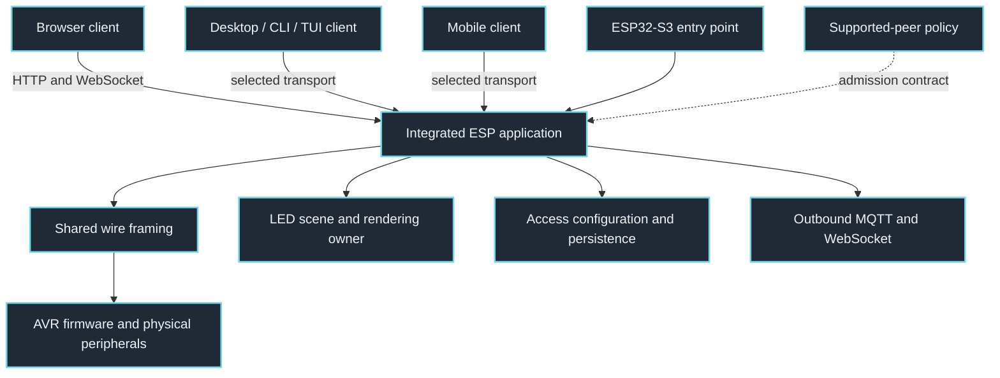
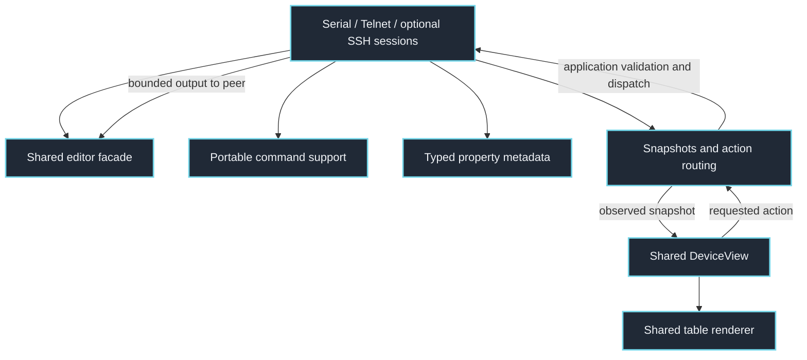
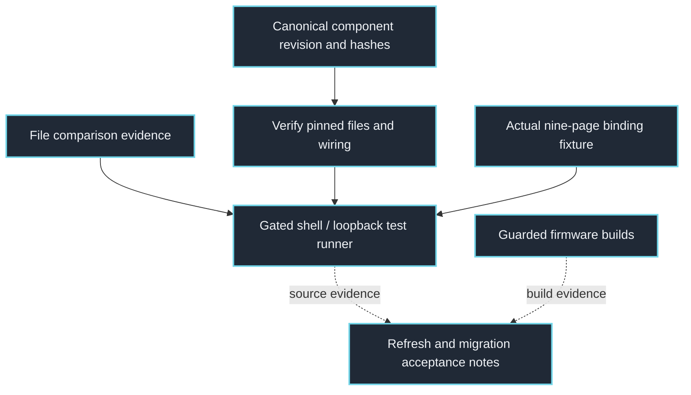

# PakarController: clickable system maps

This is a navigable companion to [the detailed architecture and gaps](ARCHITECTURE.md). The ESP owns board configuration and command admission; AVR firmware owns its physical inputs and peripherals. Clients keep drafts and display observed state. PortableShell supplies reusable terminal mechanisms.

Click a component to inspect its implementation. Links are pinned to source commit `0a80e8cc3aad5c0f8adcc554863a2f2805b38b1b`, so this map remains inspectable as the code evolves. Arrows describe source-level relationships, not proof of deployment or physical behavior.

## Whole-system ownership

Arrows show application and transport responsibilities. Optional capabilities require matching build flags, runtime configuration and observed device support.

## Terminal command and table lifecycle

ShellService owns connection/authentication, bounded output and dispatch. The TUI renders snapshots and returns actions; the application validates and applies them. On exit, mouse reporting is disabled before the alternate screen is restored.

## Refresh, validation and release boundaries

The component pin records current shared headers separately from historical reference snapshots. Passing host fixtures does not prove SSH wire interoperability, installed firmware or physical light/sound.

## Source index

These links also work in readers that disable clickable diagram nodes.

- [desktop/src/main.rs](https://github.com/atomicdeploy/PakarController/blob/0a80e8cc3aad5c0f8adcc554863a2f2805b38b1b/desktop/src/main.rs)
- [mobile/lib/main.dart](https://github.com/atomicdeploy/PakarController/blob/0a80e8cc3aad5c0f8adcc554863a2f2805b38b1b/mobile/lib/main.dart)
- [firmware/esp/application.ino](https://github.com/atomicdeploy/PakarController/blob/0a80e8cc3aad5c0f8adcc554863a2f2805b38b1b/firmware/esp/application.ino)
- [firmware/esp32s3/esp32s3.ino](https://github.com/atomicdeploy/PakarController/blob/0a80e8cc3aad5c0f8adcc554863a2f2805b38b1b/firmware/esp32s3/esp32s3.ino)
- [firmware/avr/avr.ino](https://github.com/atomicdeploy/PakarController/blob/0a80e8cc3aad5c0f8adcc554863a2f2805b38b1b/firmware/avr/avr.ino)
- [libraries/BoardCore/src/WireCodec.h](https://github.com/atomicdeploy/PakarController/blob/0a80e8cc3aad5c0f8adcc554863a2f2805b38b1b/libraries/BoardCore/src/WireCodec.h)
- [firmware/esp/src/LedGrid.h](https://github.com/atomicdeploy/PakarController/blob/0a80e8cc3aad5c0f8adcc554863a2f2805b38b1b/firmware/esp/src/LedGrid.h)
- [firmware/esp/src/AccessConfig.cpp](https://github.com/atomicdeploy/PakarController/blob/0a80e8cc3aad5c0f8adcc554863a2f2805b38b1b/firmware/esp/src/AccessConfig.cpp)
- [interfaces/peer-policy.json](https://github.com/atomicdeploy/PakarController/blob/0a80e8cc3aad5c0f8adcc554863a2f2805b38b1b/interfaces/peer-policy.json)
- [firmware/esp/src/ShellService.h](https://github.com/atomicdeploy/PakarController/blob/0a80e8cc3aad5c0f8adcc554863a2f2805b38b1b/firmware/esp/src/ShellService.h)
- [firmware/esp/src/TelnetShell.h](https://github.com/atomicdeploy/PakarController/blob/0a80e8cc3aad5c0f8adcc554863a2f2805b38b1b/firmware/esp/src/TelnetShell.h)
- [firmware/esp/src/PortableShellCore.h](https://github.com/atomicdeploy/PakarController/blob/0a80e8cc3aad5c0f8adcc554863a2f2805b38b1b/firmware/esp/src/PortableShellCore.h)
- [firmware/esp/src/ShellProperties.h](https://github.com/atomicdeploy/PakarController/blob/0a80e8cc3aad5c0f8adcc554863a2f2805b38b1b/firmware/esp/src/ShellProperties.h)
- [firmware/esp/src/ShellTuiBinding.h](https://github.com/atomicdeploy/PakarController/blob/0a80e8cc3aad5c0f8adcc554863a2f2805b38b1b/firmware/esp/src/ShellTuiBinding.h)
- [firmware/esp/src/portable-shell/portable_device_view.hpp](https://github.com/atomicdeploy/PakarController/blob/0a80e8cc3aad5c0f8adcc554863a2f2805b38b1b/firmware/esp/src/portable-shell/portable_device_view.hpp)
- [firmware/esp/src/portable-shell/portable_device_table.hpp](https://github.com/atomicdeploy/PakarController/blob/0a80e8cc3aad5c0f8adcc554863a2f2805b38b1b/firmware/esp/src/portable-shell/portable_device_table.hpp)
- [third_party/portable-shell/source.json](https://github.com/atomicdeploy/PakarController/blob/0a80e8cc3aad5c0f8adcc554863a2f2805b38b1b/third_party/portable-shell/source.json)
- [docs/file-comparison-evidence.json](https://github.com/atomicdeploy/PakarController/blob/0a80e8cc3aad5c0f8adcc554863a2f2805b38b1b/docs/file-comparison-evidence.json)
- [tests/portable_shell_source_test.mjs](https://github.com/atomicdeploy/PakarController/blob/0a80e8cc3aad5c0f8adcc554863a2f2805b38b1b/tests/portable_shell_source_test.mjs)
- [tools/test-shell.ps1](https://github.com/atomicdeploy/PakarController/blob/0a80e8cc3aad5c0f8adcc554863a2f2805b38b1b/tools/test-shell.ps1)
- [tests/shell_workspace_test.cpp](https://github.com/atomicdeploy/PakarController/blob/0a80e8cc3aad5c0f8adcc554863a2f2805b38b1b/tests/shell_workspace_test.cpp)
- [tools/build-firmware.ps1](https://github.com/atomicdeploy/PakarController/blob/0a80e8cc3aad5c0f8adcc554863a2f2805b38b1b/tools/build-firmware.ps1)
- [docs/REUSE-PREFLIGHT-RECEIPT.md](https://github.com/atomicdeploy/PakarController/blob/0a80e8cc3aad5c0f8adcc554863a2f2805b38b1b/docs/REUSE-PREFLIGHT-RECEIPT.md)
- [web/index.html](https://github.com/atomicdeploy/PakarController/blob/0a80e8cc3aad5c0f8adcc554863a2f2805b38b1b/web/index.html)
- [firmware/esp/src/CloudServices.cpp](https://github.com/atomicdeploy/PakarController/blob/0a80e8cc3aad5c0f8adcc554863a2f2805b38b1b/firmware/esp/src/CloudServices.cpp)
