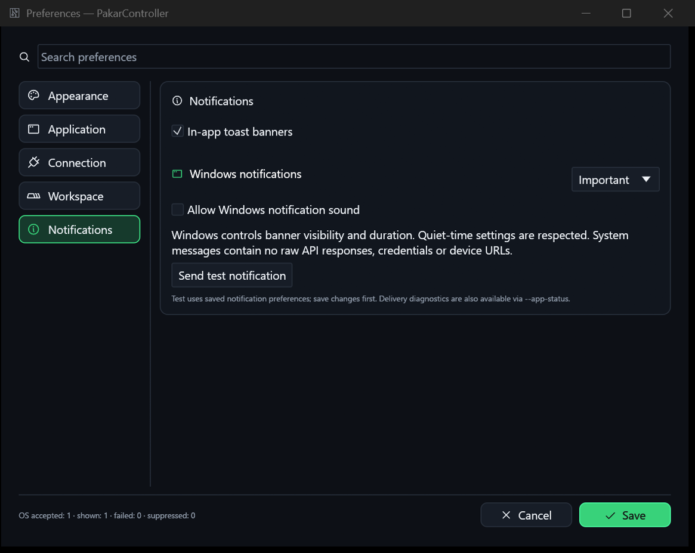

# Native Windows restoration and remaining desktop parity

At `1cf3da0ba6869acc72eb2f57223475528780420e`, native Windows notifications
were missing. The earlier foundation `b3c1a3f` imported Pealayer's in-app
MessageHub/overlay, tray, Jump List and single-instance ownership, but did not
port its OS notification wrapper or its disconnect/update callers. There was
no valid business-logic reason to omit those generic notification capabilities.

This change restores Windows Shell banner notifications, not a separate WinRT
action/progress-toast implementation. This is the actual mechanism Pealayer
uses. Microsoft's [Shell_NotifyIconW reference](https://learn.microsoft.com/en-us/windows/win32/api/shellapi/nf-shellapi-shell_notifyiconw)
describes Windows banner behavior and visibility/click callbacks. Windows,
not the application, controls visibility/duration and quiet-time behavior.

## Exact source mappings

Donor revision: `78563ff7501e13cb8e40a60dd181f69f127c550d`.

| Donor code | Pakar integration | Disposition and evidence |
|---|---|---|
| `src/messaging.rs`, complete | `desktop/src/messaging.rs` | Unchanged actual hub and upstream tests; in-app messages remain separate from OS delivery. |
| `src/ui/toasts.rs`, complete | `desktop/src/ui/toasts.rs` | Actual overlay preserved; live configuration accessor adapted and explicit enable preference added. |
| `src/platform/windows.rs:2440–2479`, `show_system_notification` | `desktop/src/platform/windows_notifications.rs` | Actual `NOTIFYICONDATAW`/`Shell_NotifyIconW(NIM_MODIFY)` route adapted to the existing tray HWND/GUID. No duplicate icon and no hardcoded donor icon ID 1. Severity, silent/sound choice, quiet-time respect, safe UTF-16 limits and visibility/click counters added. Non-Windows reports unsupported instead of false success. |
| `src/app.rs:1178–1209`, disconnect/update notices | `desktop/src/main.rs`, `platform/notifications.rs` | Fresh-authority device/AVR connection transitions, matching settings results, maintenance results and explicit operation failures feed the hub and native queue. Passive poll failures do not produce banner storms. Media pause/restart logic is excluded because there is no media engine. |
| `windows.rs:1328–1374`, taskbar API | `platform/windows_desktop.rs` | Actual `ITaskbarList3` route, balanced COM, and indeterminate activity for real pending requests. Playback-time percentages are not copied into firmware progress. Root taskbar restart/retry acceptance remains open. |
| `windows.rs:1219–1326`, palette/native caption functions | `platform/windows_desktop.rs` | Actual DWM dark/caption/text attributes and palette COLORREF mapping. Mica/legacy dark-mode fallback, child-window theming and full appearance options remain open, not claimed equivalent. |
| `src/platform/windows_quick_actions.rs`, complete | Matching desktop module, `windows_jump_list.rs`, `build.rs`, `ui/shell.rs` | Actual resource contract and traits retained. Preferences, Exit and generic fullscreen preserved. Four media-only transport/chapter/volume actions replaced by real controller navigation; eight typed actions have unique native resource IDs. |
| `src/platform/windows_shell_icons.rs`, complete | Matching desktop module and `build.rs` | Byte-identical rasterizer/ICO generator. Real generated Phosphor icons now appear in the tray menu as well as PE/Jump List assets. |
| `windows.rs` tray methods | `platform/windows_tray.rs` | Existing lifecycle through pinned `tray-icon =0.26.1`, actual callback HWND, GUID, click-to-open, status tooltip, settings entry and safe close-to-tray fallback. The library owns tray re-registration; root taskbar restart is a distinct open gate. |
| `src/application_shortcuts.rs`, complete | Current `ui/shell.rs` defaults | Actual full read uncovered missing persisted rebinding. Ctrl+comma/configuration and F11 defaults exist; configurable matching/global shortcuts are **not** restored yet. Exact omitted code/reasons are in the hash-bound comparison. |
| `tests/windows_shell_suite_test.rs`, complete | Native HWND/owner/action tests and live IPC smoke | Media tests excluded or replaced with controller tests; root lifecycle retry and hidden-window/click acceptance remain gaps. |

The complete 3,000+-line donor `windows.rs` and donor `app.rs` remain pending
whole-file comparisons. The function mappings above do **not** promote them
to complete-file parity. `FILE-COMPARISON.md` and its CSV remain the authority.

## Operational surfaces

- Preferences → Notifications: in-app banners, Off/Important/All Windows
  delivery, optional sound and a test action. Important is the default; sound
  is off. Save/Cancel/discard and exact `notifications` deep-link work.
- `PakarController.exe --preferences-page notifications`
- `PakarController.exe --notification-test`
- `PakarController.exe --app-status`: native accepted/failed/suppressed counts,
  actual Shell shown/hidden/timeout/click callbacks, policy and tray availability.
- `--device-settings`, `--refresh`, `--fullscreen` (also F11) and the shared
  launch/IPC/Jump List actions. No device mutation is issued by these actions.
- Bounded 32-message queue, category/severity cooldown and global flood limit;
  routine bursts cannot evict important queued alerts. All is still rate-limited.
- OS banners never contain raw API replies, device addresses or credentials.
  In-app Events retain the operational detail. Failures are reported without
  recursive notification loops. A success does not mask a following failure.

## Live acceptance and limitations

Local Windows runtime was replaced through graceful IPC with the prior
settings build preserved separately. The saved profile still points to
`http://ledboard.local`; it was not replaced by a fixture. Native test delivery
returned `accepted: 1`, `failed: 0`, and the Shell emitted `shown: 1`.
The notification preferences screenshot was captured and inspected.
The final artifact/PID/hash and callback receipt are delivered separately.
Final local executable: SHA-256
`b9383aeaa944b9fae59fb15b2c7ac25eb6efb93f50c9b716380dde263c07eb0a`,
23,883,776 bytes, process 40100. CLI fullscreen toggled on and back to its
original false state in that same owner. Preferences retained their original
SHA-256 `950ef1e73d2de8d6e37ea20e0cd953fe520e9d8aedf69f3dc94bb7d1a8b3a2c9`.

`tests/native_notification_smoke.mjs` is an opt-in owned-process test which
records a new accepted request **and** a new shown callback; it never launches
or quits an app or changes device/Windows parameters.

Seventy Rust tests pass, including policy, queue/flood limits, privacy, default
preferences/serialization, UTF-16, invalid HWNDs 0/42, connection freshness,
dirty-draft deep-links and all typed native actions. These do not prove someone
clicked the banner or inspected the actual Windows Jump List/tray menu.
Computer-use screenshot capture failed with `0x8007041D` and exposed no usable
accessibility tree. No stale-coordinate inputs or OS privacy changes were made.
The repository read-only capture helper and production CLI/IPC supplied evidence.

ASUS SSH at localhost:1022 still refuses the connection and the app reports the
device offline. No AVR/ESP flash, EEPROM, network setting or physical peripheral
write was performed during this desktop change. Device-triggered notice delivery
and ASUS installation remain external acceptance gates.

## Remaining useful capabilities: not approved omissions

| Capability / donor path | What is missing and why it remains open |
|---|---|
| Configurable accelerators, `src/application_shortcuts.rs` | The old foundation hardcoded bindings. The reusable model/parser, exact modifiers, repeat/release and editing safeguards need actual import/adaptation and tests; there is no approved reason to omit them. Media frame stepping/folder rules are the explicitly excluded business portions. |
| Global/hardware shortcuts, `src/hardware_shortcuts.rs` | The manager, ownership and controller action bindings are not integrated. Their actual key-code helpers must be reconciled with the custom controller protocol; importing translations alone was not implementation. |
| Native/Web/TUI notification and preference contract, `web_ui/src/messaging.ts` and preference sources | Native state exists but there is no equivalent shared app-service contract on every surface. The firmware Web UI and Android preview are separate clients, not proof of desktop-preference parity. |
| Desktop peer updating, `src/update.rs` | Firmware maintenance is not an app updater. Native staging, validation, owner/IPC exit and restart still need adaptation; a manual build replacement is not a restored updater. |
| Custom/state icons, Pealayer Appearance and Windows icon code | The actual generator is retained; user icon packs, state transitions and the full editor are not integrated. Generator presence alone was an incomplete comparison. |
| Window snapping, Mica/options, taskbar lifecycle/thumbnail navigation, `platform/windows.rs` | Some caption/taskbar API calls are now restored, but generic interaction/recovery and settings need full-file review and tests. Video frame thumbnails/transport controls are excluded because there is no video player; generic useful affordances are not automatically excluded. |
| Clipboard URL observation, `platform/clipboard_urls.rs` | Explicit paste controls exist; automatic validated endpoint/firmware-link observation does not. Media opening cannot be blindly retained, and a real safe controller-specific decision is still required. |
| Registry/config-folder integration, `platform/registry.rs`, `windows.rs::configure_config_directory` | Current JSON persistence is real, but the remaining generic donor facilities have not been completely compared. No claim of equivalence or accepted exclusion is made. |
| Translation, complete workspace snapshots and richer diagnostic views | Imported vocabulary/dock placement do not provide full business captions, all panel state or complete hardware telemetry. Existing foundation notes already listed these; they remain uncompleted work. |

Track native restoration and these acceptance gates in [issue #5](https://github.com/atomicdeploy/PakarController/issues/5); full project production acceptance remains issue #2 and complete
file-by-file parity remains issue #3. No blanket “all bells and whistles” claim.
